<!-- Aquest codi és necessari només per passar el markdown a pdf amb les pautes demanades a l'activitat -->

<style>
@page {
  margin: 2.5cm;
  @bottom-right {
    content: counter(page);
    font-size: 10pt;
    font-family: sans-serif;
  }
}

body {
  font-family: Arial, Helvetica, sans-serif;
  font-size: 11pt;
  line-height: 1.5;
}

code {
  color: rgb(234, 128, 0);
  background-color: rgb(40, 40, 40);
  padding: 2px 4px;
  border-radius: 3px;
}

.resposta {
  color: #1a5276;
  font-weight: bold;
}

.portada {
  text-align: center;
  padding-top: 50px;
}

.portada h1 {
  font-size: 24pt;
  margin-bottom: 20px;
}

.portada h2 {
  font-size: 16pt;
  color: #555;
  margin-bottom: 40px;
}

.portada .dades {
  font-size: 12pt;
  margin-top: 150px;
  text-align: left;
  border-left: 4px solid #ea8000;
  padding-left: 15px;
}

h2 {
  page-break-before: always;
}

.index-personalitzat {
  font-size: 14pt;
  line-height: 2;
}

.nota {
  font-size: 8pt;
  color: rgb(40, 40, 40);
}
</style>

<!-- PORTADA -->

<div class="portada">
  <h1>Activitat 7. Instal·lació i Administració de programari base.</h1>
  <h3>Implantació de Sistemes Operatius (0369)</h3>

  <div class="dades">
    <p><strong>Cicle Formatiu:</strong> Administració de Sistemes Informàtics en Xarxa, perfil professional Ciberseguretat (ASIX)</p>
    <p><strong>Alumne:</strong> Alex Morcillo Quiñones</p>
    <p><strong>Data:</strong> Octubre 2026</p>
  </div>
</div>

<div style="page-break-after: always;"></div>

<!-- Index -->
<div class="index-personalitzat">

- [Objectius, Competències i Requeriments](#objectius-competències-i-requeriments)
- [Apartat A. Comandes bàsiques arxius i carpetes](#apartat-a-comandes-bàsiques-arxius-i-carpetes)
- [Apartat B. Administració de la xarxa](#apartat-b-administració-de-la-xarxa)
- [Apartat C. Instal·lació de programari i actualitzacions](#apartat-c-instal·lació-de-programari-i-actualitzacions)
- [Apartat D. Logs de sistema i registre](#apartat-d-logs-de-sistema-i-registre)
- [Apartat E. Usuaris i grups](#apartat-e-usuaris-i-grups)
- [Apartat F. Memòria, processos i serveis](#apartat-f-memòria-processos-i-serveis)
</div>

<div style="page-break-after: always;"></div>

<!-- Aquí comença l'activitat -->

### **Objectius:**
L’objectiu principal d’aquesta pràctica és posar en pràctica conceptes bàsics sobre l’administració d’un sistema operatiu mitjançant el desenvolupament d’una sèrie de tasques de forma individual.

### **Competències professionals, personals i socials**
Avaluar el rendiment dels dispositius maquinari identificant-ne possibilitats de millora segons les necessitats de funcionament.

### **Requeriments:** 
- A partir d’una màquina virtual ja existent amb Ubuntu, crea un clon. Recorda reiniciar l’adreça MAC d’aquesta nova màquina per a no tenir conflictes.

## **Apartat A. Comandes bàsiques arxius i carpetes**

#### 1. Crea al teu home, el directori ACTIVITAT7. Dins, crea la següent estructura de directoris, creant els directoris d’un en un.

```text
/ACTIVITAT7 
    └── Exercici1
        └── Primer
            └── aplicacions
            └── programacio
            └── maquinari
        └── Segon
            └── bd
            └── fol
            └── sistemes
```
- Per fer aquesta estructura només hem de fer servir dues comandes **`mkdir`** i **`cd`**
    - Primer ens assegurem d'estar al nostre directori **/home/el_teu_usuari** fent `cd`, on veurem **usuari@maquina:~$**
    - Comencem amb `mkdir ACTIVITAT7` i entrem al directori amb `cd ACTIVITAT7`
    - Fem el següent directori amb `mkdir Exercici1` i hi entrem amb `cd Exercici1`
    - Ara que som al directori **~/ACTIVITAT7/Exercici1** aprofitem per crear el directori **Primer** i **Segon**
    - `mkdir Primer` i `mkdir Segon` i entrem a Primer amb `cd Primer`
    - Una vegada al directori podem crear els tres directoris utilitzant `mkdir`
    - Per tornar a **~/ACTIVITAT7/Exercici1** utilitzarem `cd ..` (`cd ..` sempre ens fa retrocedir un directori). Alternativament podem fer `cd ~/ACTIVITAT7/Exercici1`
    - Entrem al directori anomenat Segon amb `cd Segon` i una vegada dins creem els tres directoris amb `mkdir`

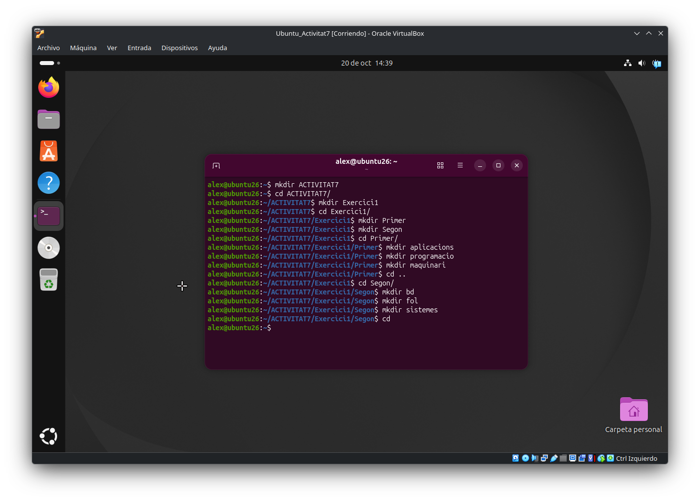

#### 2. Crea a ACTIVITAT7 el directori exercici2 i dins, els directoris amb una sola ordre, segons la següent estructura de directoris.

```text
/ACTIVITAT7 
    └── Exercici2
        └── Primer
            └── ofimatica
            └── xarxes
        └── Segon
            └── empresa
            └── administracio
```
- En aquest apartat utilitzarem mkdir d'una manera més avançada/optimitzada, però és igual de fàcil!
    - Primer ens assegurem d'estar al nostre directori **/home/el_teu_usuari** fent `cd`, on veurem **usuari@maquina:~$**
    - Amb una única comanda creem tot: `mkdir -p ACTIVITAT7/Exercici2/{Primer/{ofimatica,xarxes},Segon/{empresa,administracio}}`
    - `mkdir` ja sabem que és per crear un directori, `-p` s'utilitza per crear directoris "pare" si és que no existeixen (en aquest cas crea Exercici2) i separem les rames amb `{}`, **Primer** i **Segon**, i dintre de cada directori amb un altre `{}` la resta de directoris. Separem tots els noms amb `,`
    - Verifiquem que estigui tot correcte amb `tree ACTIVITAT7` (Pot ser necessari instal·lar-ho amb `sudo snap install tree`)

    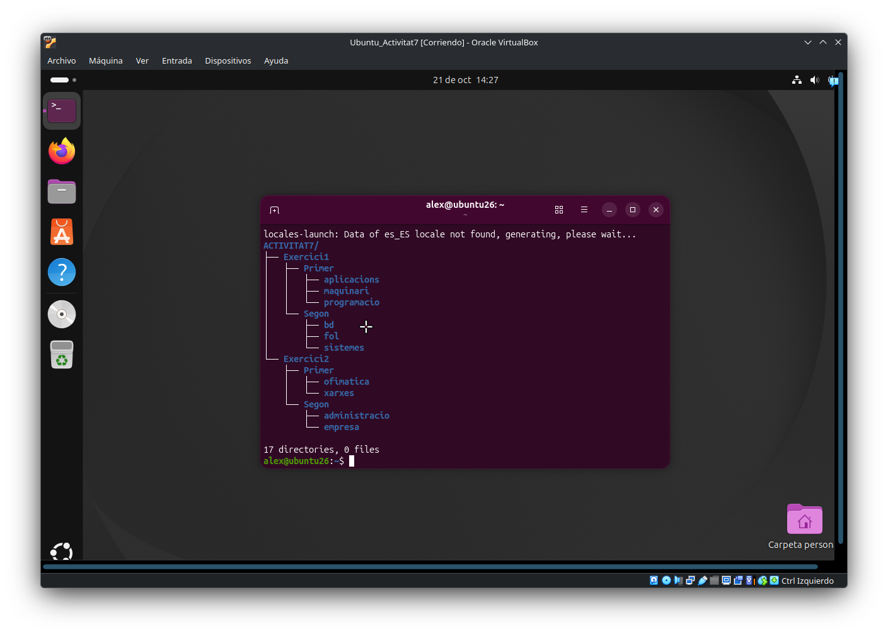

#### 3. Crea a ACTIVITAT7 el directori Exercici3. Situa’t a Exercici2 i crea dins d'Exercici3 els directoris Primer i Segon. Situa’t al directori /home/usuari/ACTIVITAT7/exercici3/primer i crea els directoris projecte i practiques.
- Per crear **Exercici3** hem de fer des de **home/el_teu_usuari/ACTIVITAT7** un `mkdir Exercici3`
- La següent comanda per crear **Primer** i **Segon** a **Exercici3** mentre som a **Exercici2** es pot fer de diferents formes. El primer pas comú és fer `cd Exercici2`. Jo he triat fer-ho amb la comanda: `mkdir -p ../Exercici3/{Primer,Segon}`

- Aquesta última comanda en la qual hem de crear **projecte** i **practiques** des de **/home/usuari/ACTIVITAT7/Exercici3/primer** es pot fer de la mateixa manera que l'anterior, però jo he triat fer-ho d'una manera diferent per ensenyar altres comandes que podem utilitzar. La manera que considero ser la més senzilla és: primer fem `cd` a la ruta on hem d'estar i a continuació fem la comanda `mkdir {projecte,practiques}`
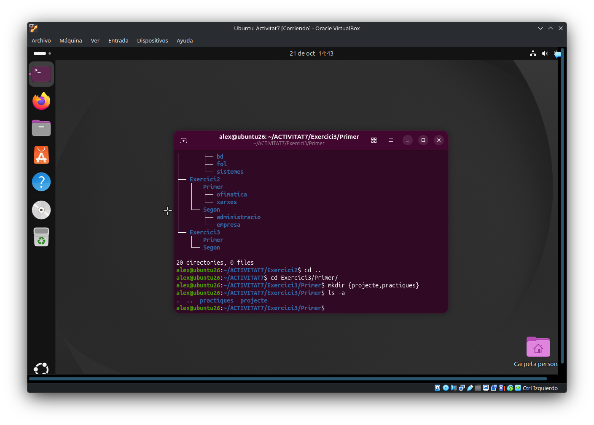

#### 4. Situa’t al teu directori home i executa les següents comandes:

`man ls > llistat.txt`

`man cp > copia.txt`

#### 5. Mostra per pantalla el contingut del teu directori de treball o directori home.
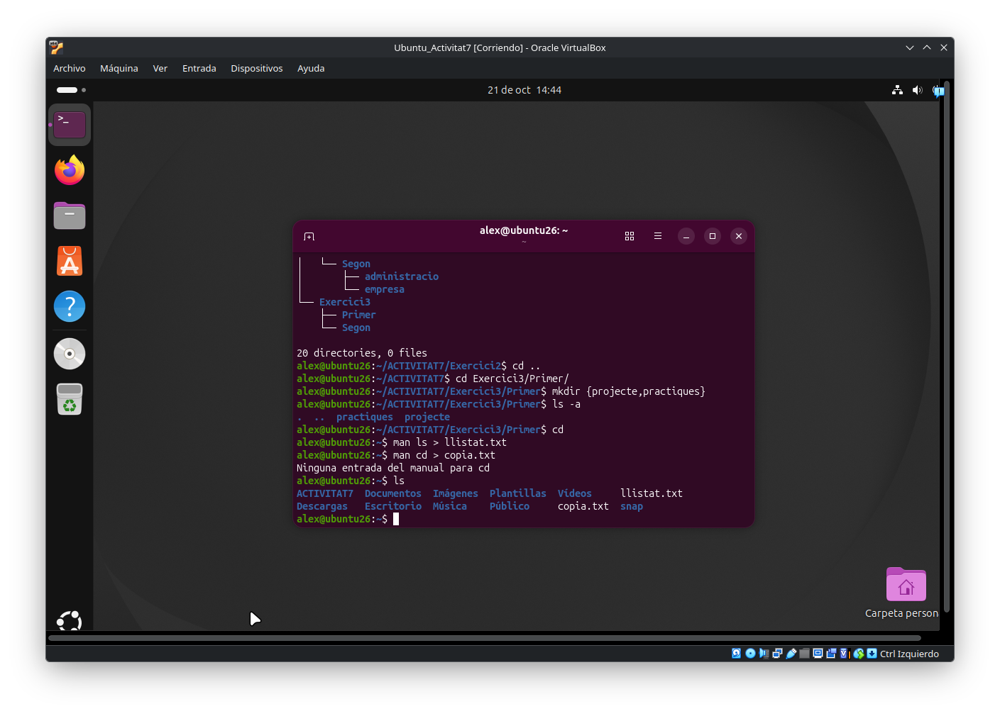

#### 6. Fes una còpia de l’arxiu “llistat.txt” a “llistat2.txt”
- Utilitzem la comanda `cp llistat.txt llistat2.txt`
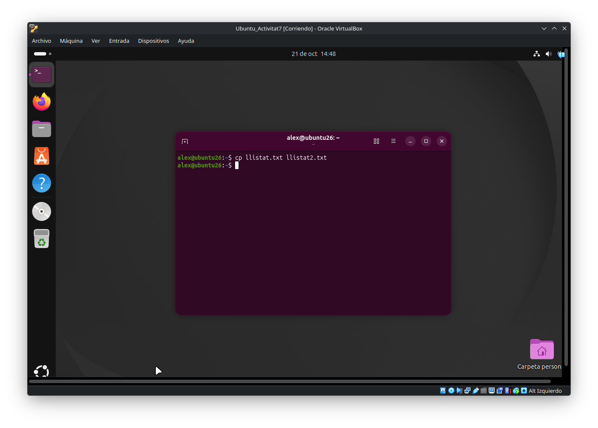

#### 7. Crea amb una comanda l’arxiu “notes.txt”

- Utilitzem `touch notes.txt`
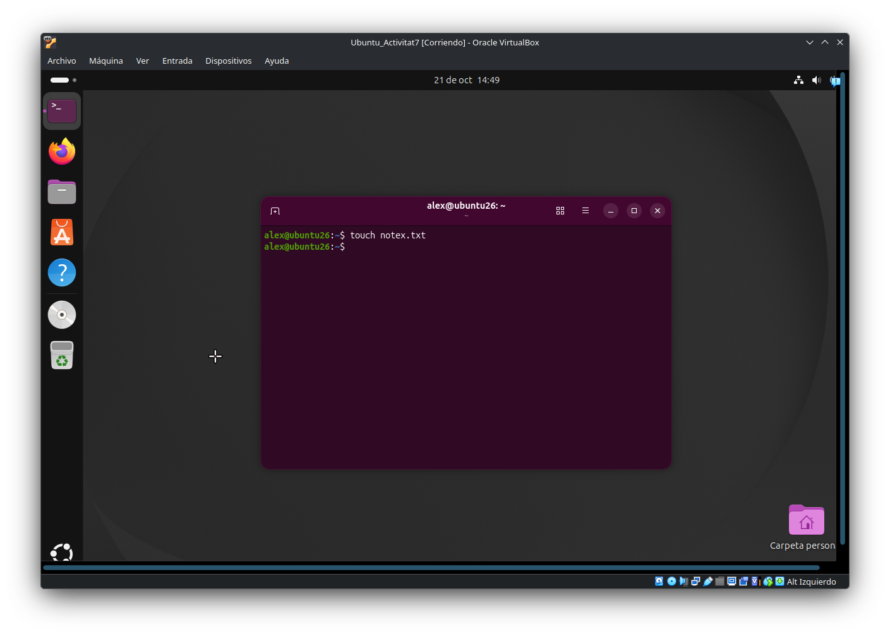

#### 8. Mou l’arxiu “notes.txt” al directori primer (d'Exercici3)

- Utilitzarem `mv notes.txt ./ACTIVITAT7/Exercici3/Primer`
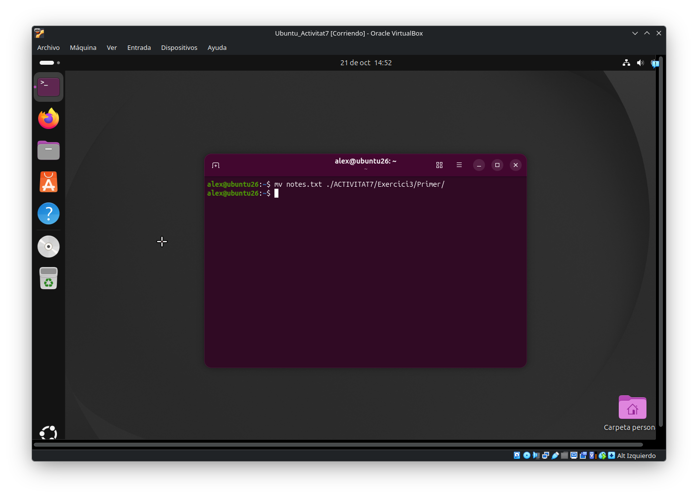

#### 9. Reanomena l’arxiu “notes.txt” com a expedient.txt des del teu directori de treball

- Utilitzarem la comanda `mv ./ACTIVITAT7/Exercici3/Primer/notes.txt ./ACTIVITAT7/Exercici3/Primer/expedient.txt`
- Podem verificar que tot està correcte amb `ls ./ACTIVITAT7/Exercici3/Primer/`. Aquesta comanda ens serveix per verificar qualsevol directori, `ls` és List Directory.

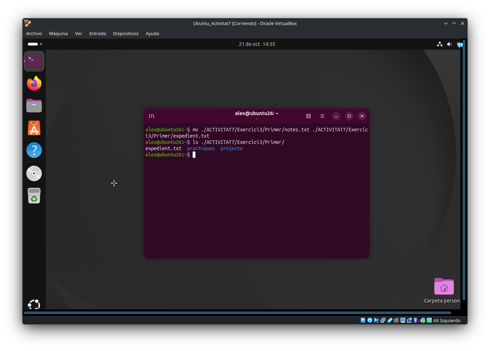

#### 10. Esborra el fitxer “llistat.txt” des del teu directori de treball.

- Utilitzem `rm llistat.txt`
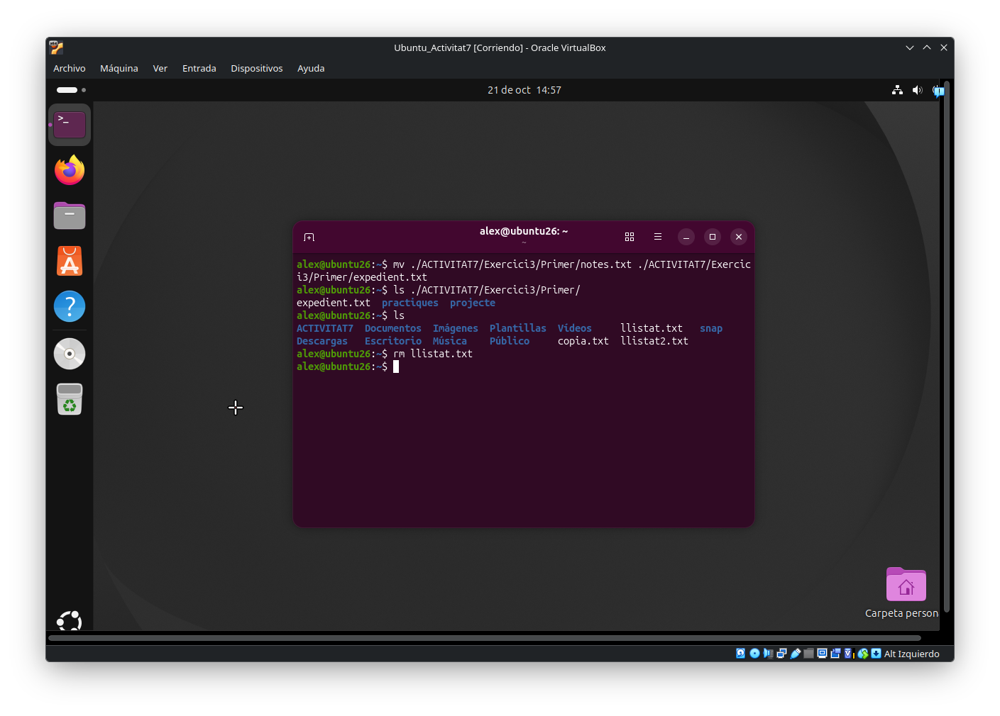

#### 11. Esborra el directori primer (d'Exercici3), utilitzant ruta absoluta

- Com ens demana la ruta absoluta hem d'escriure la ruta completa juntament amb la comanda `rm`. Quedaria així: `rm -rf ~/ACTIVITAT7/Exercici3/Primer/`
  - *Com podeu veure a la captura m'he barallat amb la comanda inicial.* La comanda final utilitza `rm -rf` ja que `rmdir` només esborra directoris sense contingut i `rm` només esborra fitxers, però combinant `rm` amb `-r` i `-f` tenim que `rm` elimina `-r` (recursivament) i `-f` (forçadament).
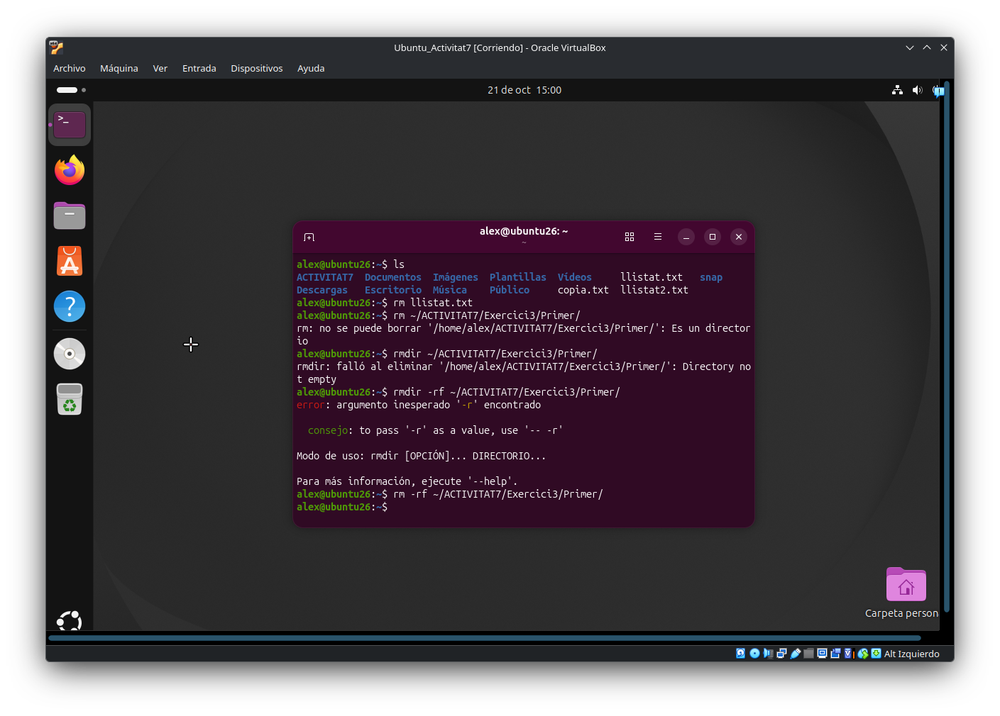

#### 12. Esborra el directori segon (d'Exercici3), des del teu directori de treball, utilitzant ruta relativa.

- Aquí, ja sabent la comanda correcta, fem el mateix però canviant **Primer** per **Segon**: `rm -rf ./ACTIVITAT7/Exercici3/Segon/`

#### 13. Situa’t al directori Exercici1 i esborra el directori Exercici3.

- Amb `cd ~/ACTIVITAT7/Exercici1` ens situem al directori.
- Llavors podem de nou utilitzar la ruta relativa. Una altra manera de fer-ho és amb: `rm -rf ../Exercici3`
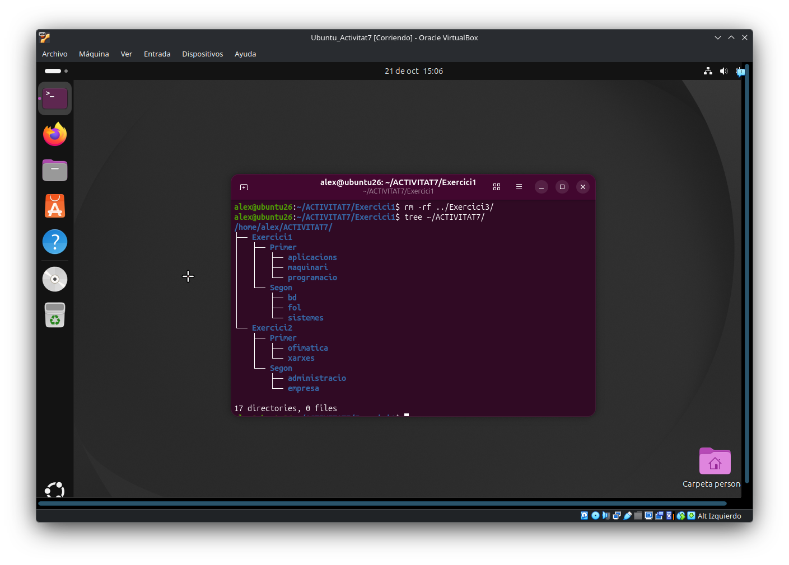

#### 14. Situa’t al directori primer (d'Exercici2) i esborra el directori segon (d'Exercici1).

- Ara hem de fer `cd ../Exercici2/Primer`
- Podem fer qualsevol de les comandes anteriors, per mi és més ràpid fer: `rm -rf ../../Exercici1/Segon`

#### 15. Situa’t al directori Exercici2 i esborra Exercici1.

- Fem `cd ..`
- Una vegada al directori correcte utilitzem: `rm -rf ../Exercici1`
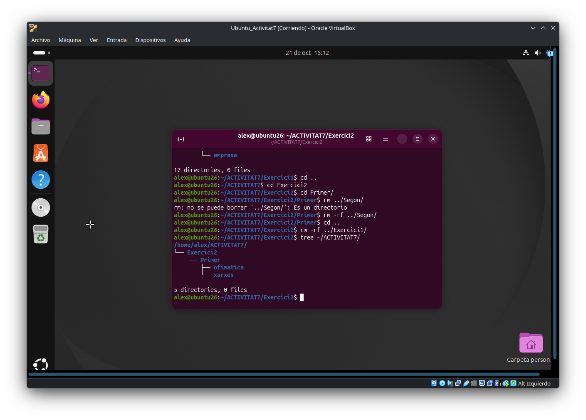

#### 16. Esborra el directori ACTIVITAT7.

- Amb `cd` o `cd ~` ens situem a home i podem fer com ja hem vist: `rm -rf ACTIVITAT7`
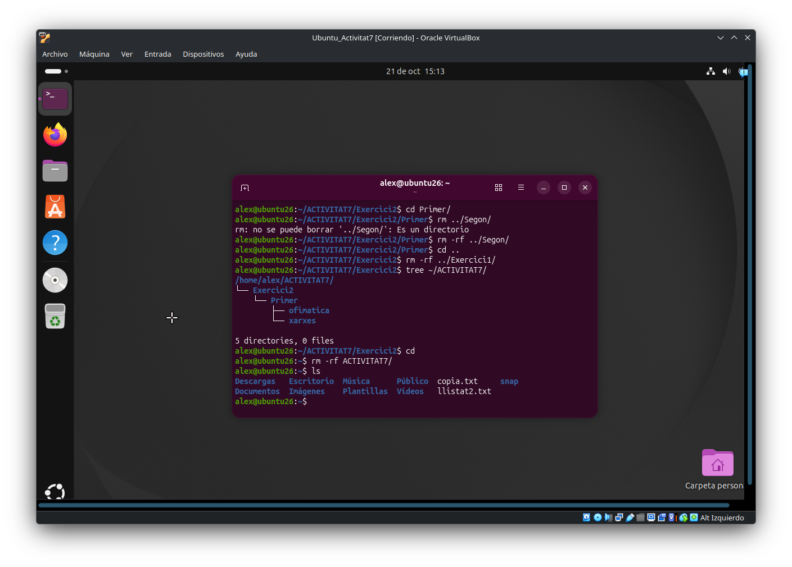

## **Apartat B. Administració de la xarxa**

#### 1. Canvia la configuració de xarxa de la màquina virtual a mode "Adaptador Pont" i engega la màquina virtual.

- A la barra superior fer clic a Dispositius > Red > Preferencias
- Una vegada oberta la configuració canviem de NAT a Adaptador Pont.
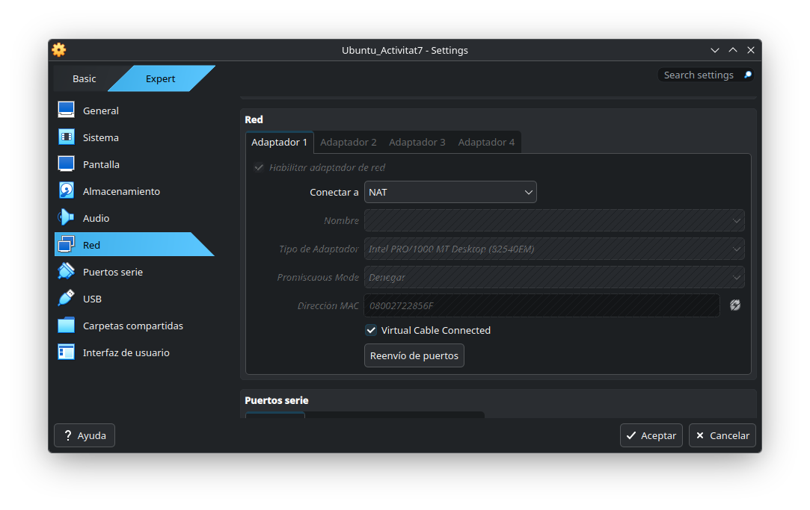

#### 2. Comprova l’adreça IP que té la teva màquina.

- Amb `ip a` podrem veure la nostra IP. La meva és la 172.18.8.123
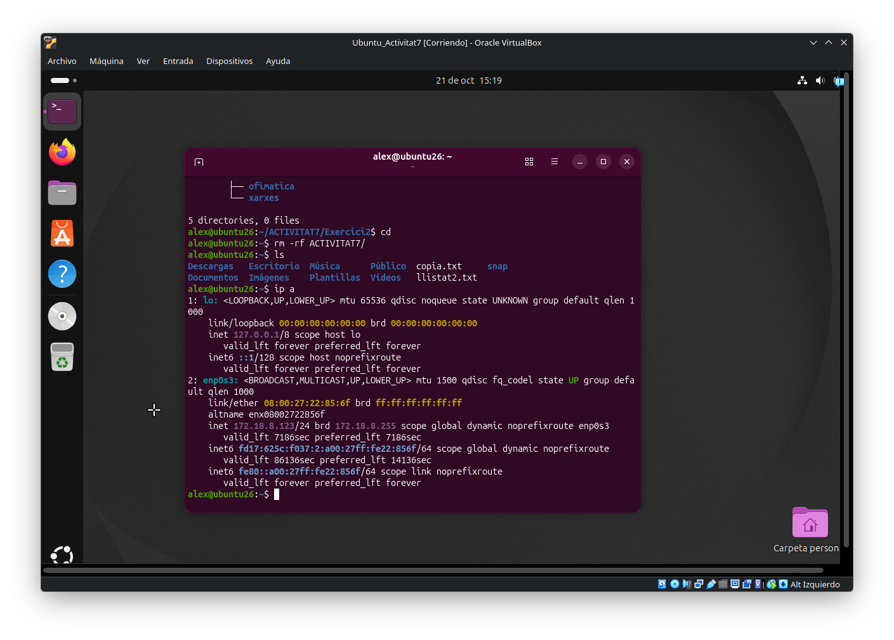

#### 3. Qui t’ha assignat aquesta adreça IP?

-  Després de revisar amb `nmcli device show` i ajudant-me de la IA, he determinat que el servidor DHCP de l'institut m'ha assignat aquesta IP.
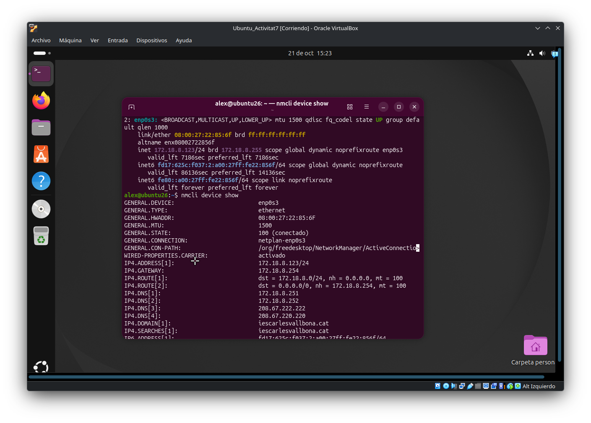

#### 4. A quina classe pertany l’adreça IP assignada?

- És una IP de classe B ja que el seu primer octet està entre el 128 i el 191.

#### 5. Quina és la seva màscara de xarxa assignada?

- Hauria de ser 255.255.0.0 (amb adreça de xarxa 172.18.0.0), però com podem veure a la captura anterior realment el servidor ens ha assignat una xarxa /24. Per tant, en comptes de ser 255.255.0.0 és 255.255.255.0 i la seva adreça de xarxa és 172.18.8.0.

#### 6. Fes el necessari per configurar aquesta adreça IP fixa. Ho has de fer en mode comanda.

- Primer hem de localitzar el fitxer de configuració, utilitzarem `ls /etc/netplan/` i buscarem un arxiu .yaml. *Normalment es diu 99-netplan-config.yaml, 01-network-manager-all.yaml o similar*.
- Amb l'editor integrat `nano` editarem el fitxer utilitzant la comanda: `sudo nano /etc/netplan/01-network-manager-all.yaml`
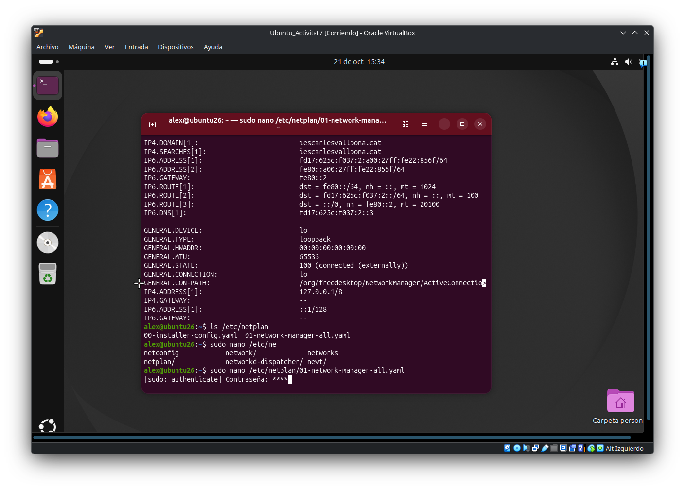
- Amb `#` comentem (o també podem esborrar) el text que hi ha escrit i afegim:
```yaml
network:
  version: 2
  renderer: NetworkManager
  ethernets:
    enp0s3:
      dhcp4: no
      addresses:
        - 172.18.8.123/24
      routes:
        - to: default
          via: 172.18.8.254
      nameservers:
        addresses:
          - 172.18.8.251
          - 172.18.8.252
```
*Degut a un canvi d'aula he necessitat canviar les IPs introduïdes al principi i associar-les a la meva adreça MAC per evitar problemes:*
```yaml
network:
  version: 2
  renderer: NetworkManager
  ethernets:
    enp0s3:
      match:
        macaddress: 08:00:27:22:85:6f
      dhcp4: no
      addresses:
        - 172.16.101.123/24
      routes:
        - to: default
          via: 172.16.101.254
      nameservers:
        addresses:
          - 8.8.8.8
```
- Guardem amb **Ctrl + O** i sortim amb **Ctrl + X**
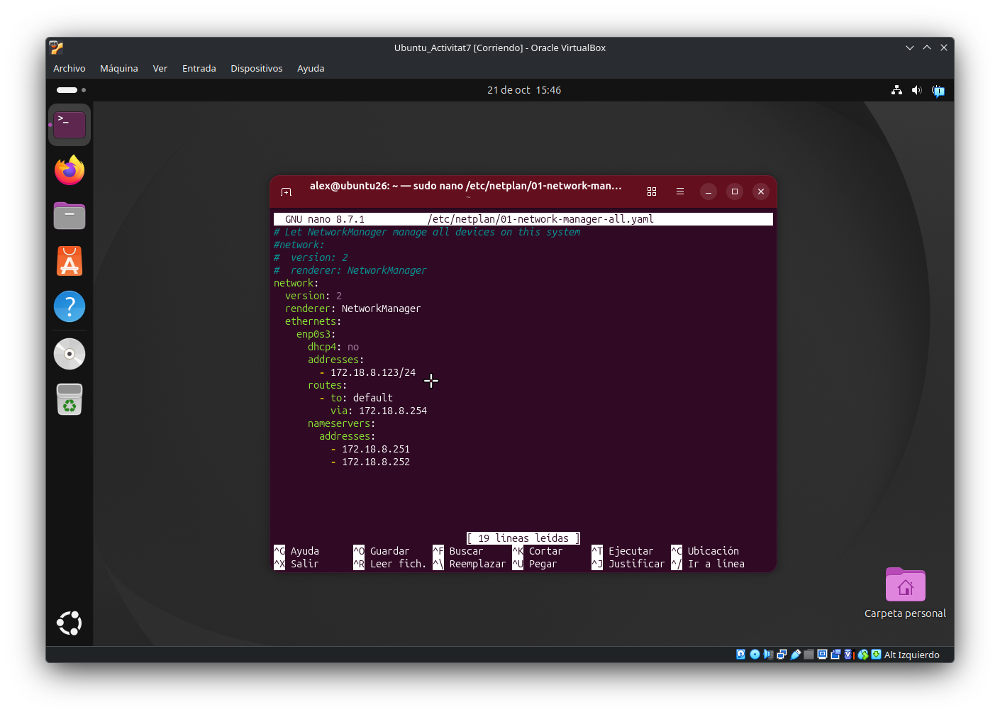

#### 7. Comprova la taula ARP i la taula d’enrutament.

- Fem `ip route` per comprovar la ruta i `ip neigh` per la taula ARP.
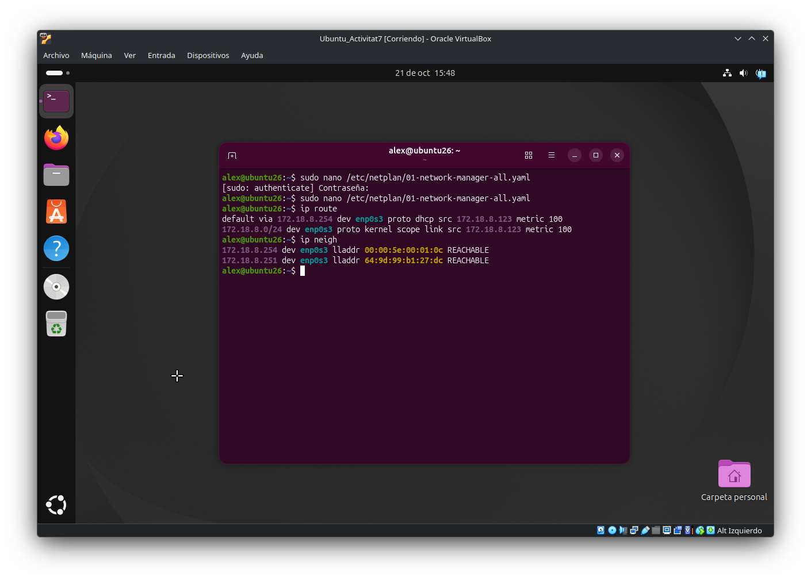

## **Apartat C. Instal·lació de programari i actualitzacions**

#### 1. Comprova que el sistema base està actualitzat. Si no està actualitzat, l’has d’actualitzar.

- Podem revisar i actualitzar amb `sudo apt update && sudo apt upgrade`
- Si hi ha alguna cosa per actualitzar ens demanarà si volem o no; amb 'y' diem que sí i amb 'n' que no. Premem 'y' i Enter per fer-ho tot.

#### 2. Utilitzant tots els mètodes d’instal·lació que coneixes, instal·la programari, a la teva elecció, a la màquina virtual. 

- Jo he instal·lat VS Code, utilitzant Snap: `sudo snap install code --classic`
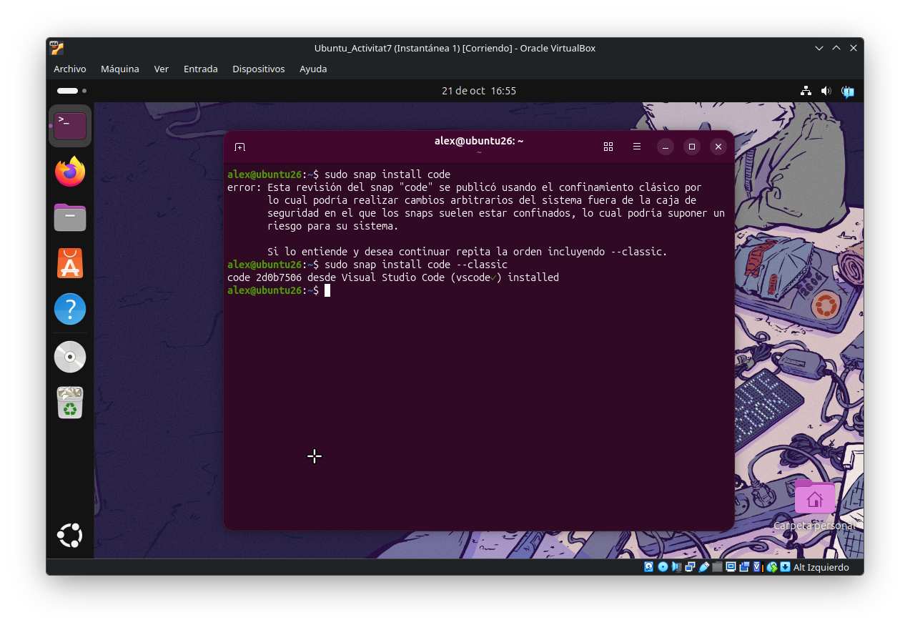

#### 3. Visualitza amb alguna comanda el programari que has instal·lat (versió i directoris d’instal·lació). 

- Amb `code copia.txt` obrim el VS Code i podem editar directament el fitxer copia.txt.
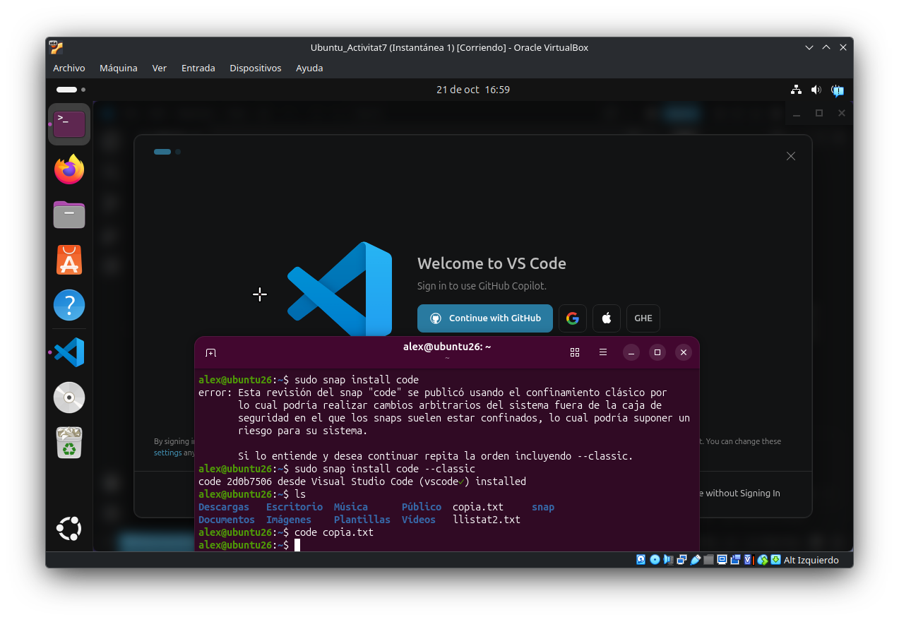

#### 4. Utilitza també un mètode de desinstal·lació.

- Tenim tres opcions per fer això:
  - `sudo apt remove code` per desinstal·lar l'app.
  - `sudo apt purge code` per desinstal·lar l'app i eliminar els arxius de configuració.
  - `sudo snap remove code` si l'hem instal·lat en la versió snap.
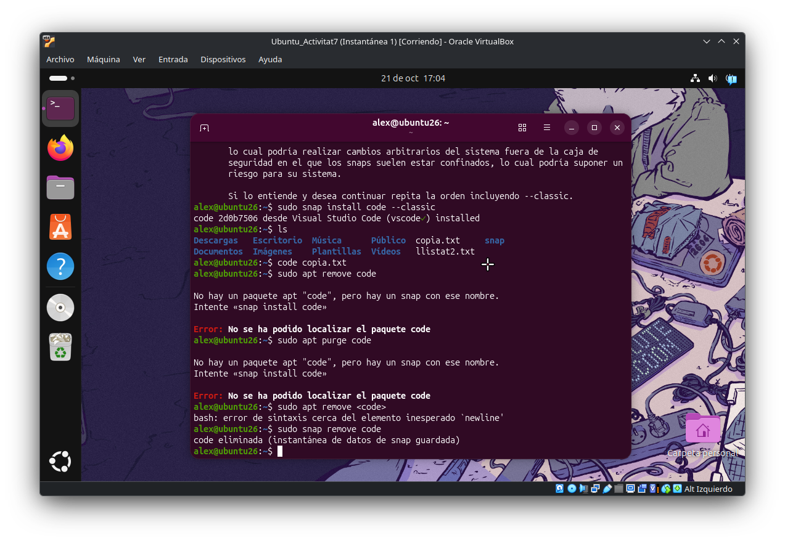

## **Apartat D. Logs de sistema i registre**

#### 1. Visualitza els logs del sistema per comprovar que apareixen registres de les instal·lacions fetes als exercicis anteriors.

- En sistemes basats en Debian/Ubuntu, els registres d'instal·lació de paquets es guarden principalment als directoris de `/var/log/apt/` i `/var/log/`.
- Per comprovar l'historial d'instal·lacions d'alt nivell (les comandes que hem executat com a usuaris), visualitzem el fitxer *history.log* de l'apt: `cat /var/log/apt/history.log`
  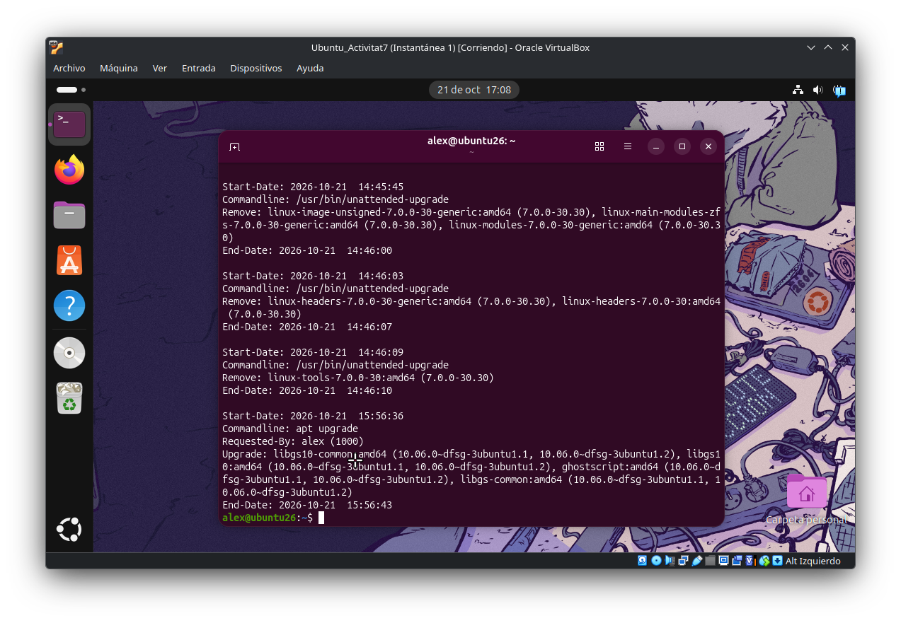

- També podem comprovar el registre de baix nivell del sistema de paquets filtrant el fitxer `dpkg.log` per veure el moment exacte en què cada paquet ha canviat al seu estat "install": `grep " install " /var/log/dpkg.log | tail -n 10`
  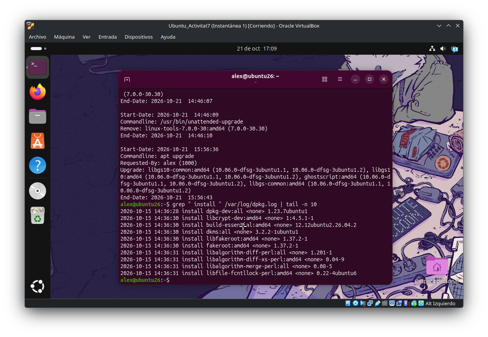

## **Apartat E. Usuaris i grups**
 
#### 1. Crea tres usuaris: usuari1 = nom, usuari2 = cognom1, usuari3 = cognom2     (amb les teves dades). 

- El meu nom és Alex Morcillo Quiñones. Per agilitzar i evitar crear usuaris que ja existeixen crearé **ale**, **mor**, **qui**.
- Creem cada usuari i li donem una contrasenya amb les comandes:
  `sudo useradd -m ale && sudo passwd ale`
  `sudo useradd -m mor && sudo passwd mor`
  `sudo useradd -m qui && sudo passwd qui`
  *(podem ignorar l'error de seguretat si ens indica que és massa curta la contrasenya).*

#### 2. Crea dues carpetes a /home: carpeta1 = nomCognom1, carpeta2 = cognom2.     L’usuari 1 és el propietari de la carpeta 1. L’usuari 3 és el propietari de la carpeta 2. L’usuari 1 i 2 podran accedir a la carpeta 1 i crear, modificar i eliminar fitxers. L’usuari 3 pot accedir a la carpeta 1, però tan sols pot llistar i visualitzar els fitxers. L’usuari 2 i 3 podran accedir a la carpeta 2, però l’usuari 1 no pot accedir-hi. *totes les carpetes les crearem a /home/alex per evitar utilitzar sudo cada vegada que creem directoris*

- Tot i que hem creat les carpetes dins del nostre directori (`/home/alex/alexmorcillo` i `/home/alex/quinones`), necessitarem utilitzar `sudo` per canviar-ne el propietari, ja que un usuari estàndard no pot transferir la propietat d'un directori a un altre usuari.

- Per complir amb els requisits, utilitzarem la gestió de grups de Linux: afegirem l'usuari 2 (`mor`) als grups principals de l'usuari 1 (`ale`) i de l'usuari 3 (`qui`).

  1. **Afegim l'usuari 2 als grups corresponents:**
    `sudo usermod -aG ale mor`
    `sudo usermod -aG qui mor`

  2. **Configurem la Carpeta 1**
    - Assignem el propietari `ale` i el grup `ale`: `sudo chown ale:ale alexmorcillo`
    - Apliquem permisos `775` (Propietari: rwx, Grup: rwx, Altres: r-x): `sudo chmod 775 alexmorcillo`

  3. **Configurem la Carpeta 2**
    - Assignem el propietari `qui` i el grup `qui`: `sudo chown qui:qui quinones`
    - Apliquem permisos `770`: `sudo chmod 770 quinones`

#### 3. Comprova als fitxers de configuració corresponents que t’ha creat els usuaris i els grups.

- Podem comprovar que s'han aplicat correctament fent un `ls -l`.
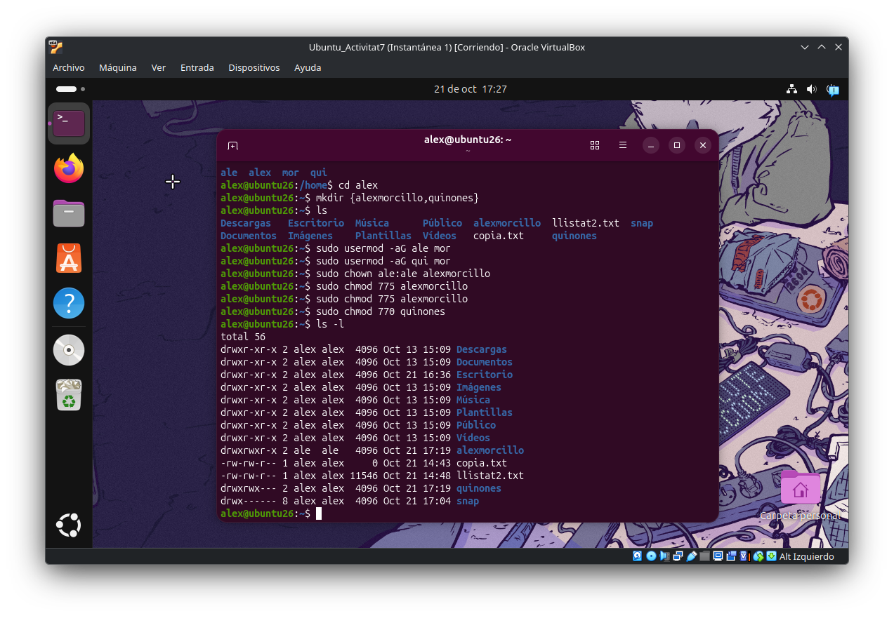

- A Linux, la informació local dels usuaris es guarda al fitxer **/etc/passwd** i la informació dels grups al fitxer **/etc/group**.
- Per comprovar que s'han creat els usuaris **ale**, **mor** i **qui**, podem utilitzar la comanda `grep` per filtrar només les línies que ens interessen del fitxer **/etc/passwd**: `grep -E "ale|mor|qui" /etc/passwd`


- Per verificar els grups i assegurar-nos que les modificacions del pas anterior han funcionat, filtrarem el fitxer **/etc/group**: `grep -E "ale|mor|qui" /etc/group`
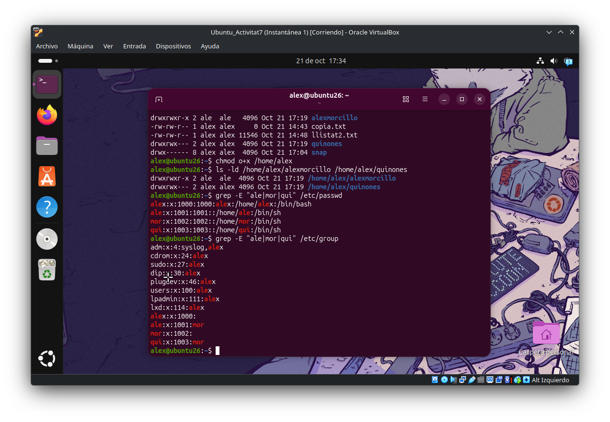

## **Apartat F. Memòria, processos i serveis**

#### 1. Llista els processos que s’estan executant al sistema.

- Per veure els processos en temps real de forma interactiva, la comanda estàndard que ve preinstal·lada és `top`. *(Nota: A títol personal prefereixo eines més modernes com `btop` o `htop`, però `top` és universal).*
- Si en canvi volem una llista estàtica i completa de tots els processos en aquell instant exacte, la comanda ideal és `ps aux`.

#### 2. Obre LibreOffice (prèviament ha d’estar tancat) i comprova que hi és a la llista. Elimina’l de la llista amb una comanda

- Jo no tenia LibreOffice instal·lat i he fet primer `sudo apt install libreoffice`, obrim LibreOffice.
- Tot i que podem buscar el procés manualment dins de `top`, la millor manera de comprovar que està a la llista i obtenir el seu **PID** és filtrant els processos amb `grep` o utilitzant `pgrep`.
- Cal tenir en compte que el procés principal de LibreOffice s'anomena `soffice.bin`. Podem fer servir: `ps aux | grep office` o `pgrep soffice.bin`
- Un cop la comanda ens retorna el número de PID, procedim a eliminar-lo de la llista enviant-li un senyal de terminació amb la comanda `kill`: `kill 12905`
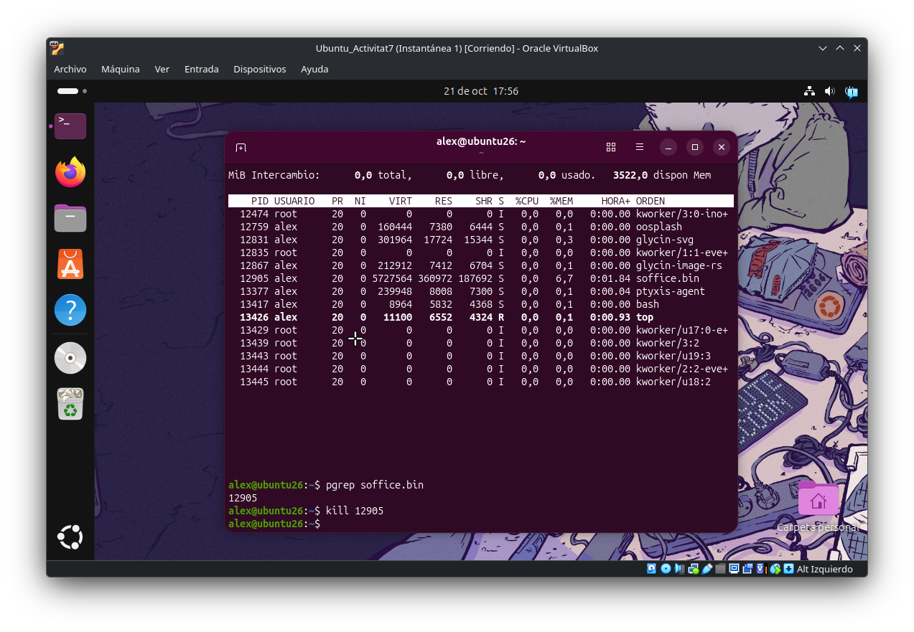

- *Alternativament des de dins del mateix programa `top`, també podem prémer la tecla `k`, introduir el PID, prémer Enter, i enviar el senyal 15 (SIGTERM) o 9 (SIGKILL) per tancar-lo.*

#### 3. Amb una comanda, obre Firefox en segon pla (prèviament ha d’estar tancat). Elimina’l. 

- Per executar qualsevol programa des de la terminal i que quedi en segon pla, hem d'afegir el símbol `&` al final de la instrucció.
- Executem la següent comanda: `firefox &`
- En fer això, la terminal ens retornarà immediatament un número de tasca entre claudàtors i el **PID** del procés acabat de crear. Per exemple: `[1] 13540`.
- Per tancar-lo, podem utilitzar el número PID que ens acaba de donar la consola i fer servir la mateixa comanda que a l'exercici anterior: `kill 13540`.
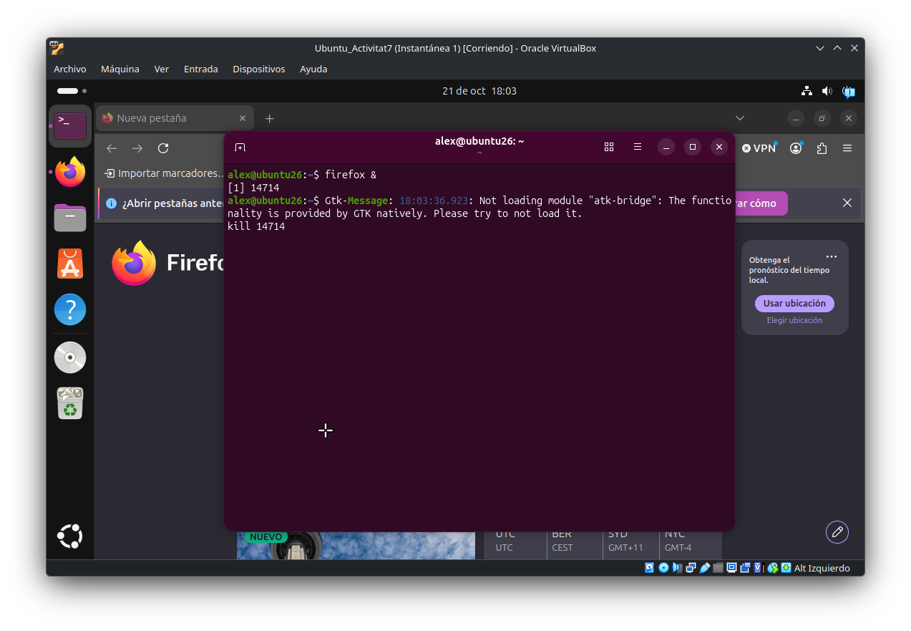

#### 4. Amb una comanda obre Firefox, què li passa al terminal? Amb una combinació de tecles, para el Firefox. Amb una comanda obre Firefox i atura el procés (posa’l en espera). Podem navegar? Recupera el procés amb una comanda.   

- **Què li passa al terminal?** Si executem simplement `firefox` (sense afegir `&` al final), el navegador s'obre, però **la terminal queda bloquejada** (s'executa en primer pla o *foreground*). La consola es queda capturant la sortida del programa i no ens retorna el prompt per introduir noves comandes.
- **Parar-lo amb el teclat:** Per forçar el tancament del Firefox des d'aquesta terminal bloquejada, utilitzem la drecera **`Ctrl + C`**. Això envia un senyal d'interrupció (SIGINT) que mata el procés immediatament i allibera la consola.
- **Pausar/Posar en espera:** Tornem a obrir el navegador escrivint `firefox`. Ara, en lloc de matar-lo, premem la combinació de tecles **`Ctrl + Z`** a la consola. Això envia un senyal de suspensió (SIGTSTP) que posa el procés en estat "Aturat" (*Stopped*) i l'envia al segon pla.
- **Podem navegar?** **No, no podem.** En pausar el procés, l'execució del programa es congela completament. La finestra de Firefox seguirà visible a la pantalla, però estarà totalment bloquejada (penjada); no podrem fer clic, ni fer scroll, ni carregar cap web.
- **Recuperar el procés:** Per fer que el Firefox torni a la vida, hem d'utilitzar comandes de gestió de tasques (*jobs*):
  - Si escrivim **`fg`** (*foreground*), el procés es descongela però torna a bloquejar la nostra terminal.
  - Si escrivim **`bg`** (*background*), el procés es descongela i funciona amb normalitat, però es queda en segon pla (com si haguéssim posat un `&` a l'inici), permetent-nos navegar i usar la consola alhora.
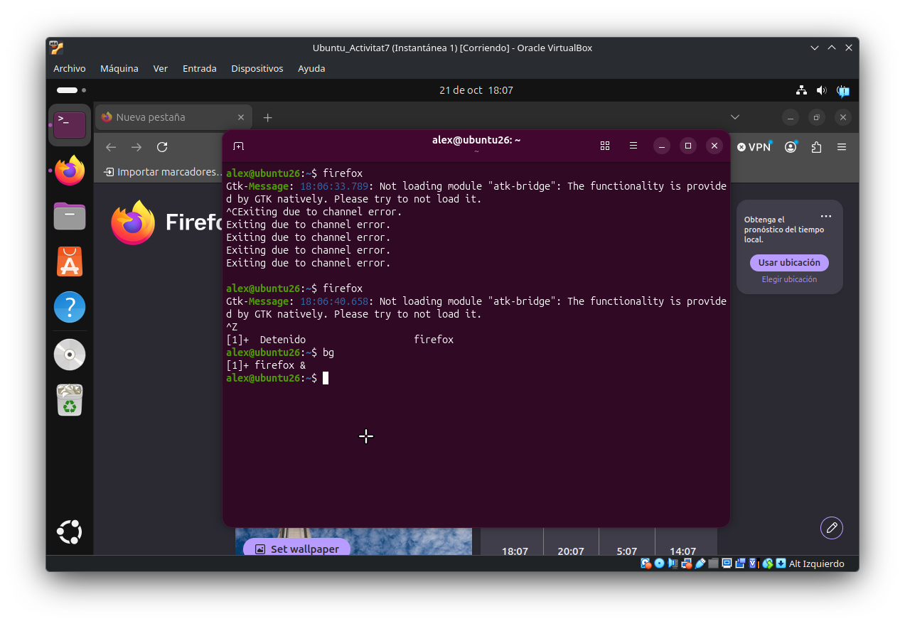

#### 5. Mostra l’activitat del sistema en temps real. Quanta memòria en MB té el sistema? Quanta memòria en MB està en ús? Quanta memòria en MB tenim a la swap?

- He utilitzat `btop`. Tot i que aquesta eina mostra les dades en GiB per defecte, podem extreure'n els valors sol·licitats fent la conversió (1 GiB = 1024 MB):
  - **Memòria Total:** Com s'observa a la captura, tenim **5.14 GiB**, la qual cosa equival a uns **5263 MB**.
  - **Memòria en ús:** El sistema està consumint **1.56 GiB**, la qual cosa es tradueix en **1597 MB**.
  - **Memòria Swap:** A la vista actual de `btop` no apareix reflectida la memòria d'intercanvi (Swap). Això acostuma a passar si no hi ha cap partició configurada o si el consum és absolutament zero i la interfície l'amaga. 
- Amb `free -m` podem veure-ho tot també d'una manera més clara però no a temps real.
- Segons la sortida per pantalla, les dades de la meva màquina virtual són les següents:
  - **Memòria Total:** 5266 MB.
  - **Memòria en ús:** 1589 MB.
  - **Memòria Swap (Inter):** 0 MB.
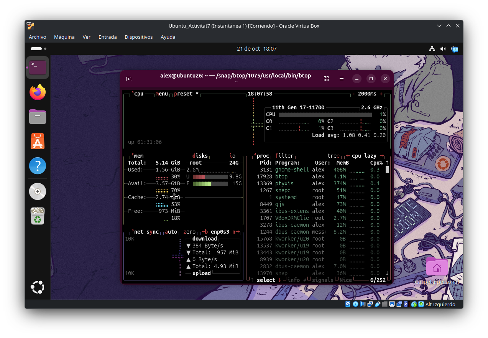
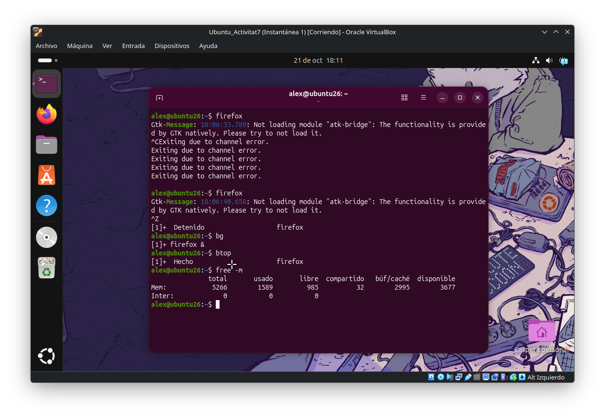
<div class="nota">

*Ús de la IA (Gemini): En aquesta activitat he utilitzat la IA per corregir errors ortogràfics, i d'estructura del markdown, juntament amb el corrector de [Softcatalà](https://www.softcatala.org/corrector/) també s'ha utilitzat gemini i la IA de Google.com per consultar algunes comandes*

</div>