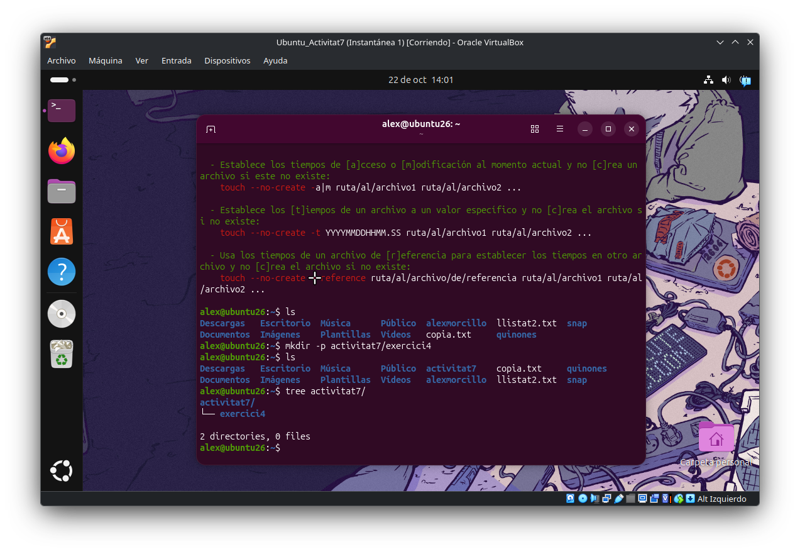

<!-- Aquest codi és necessari només per passar el markdown a pdf amb les pautes demanades a l'activitat -->

<!-- PORTADA -->

  <h1>Extension Activity 7. Installation and Administration of base software.</h1>
  <h3>Implementation of Operating Systems (0369)</h3>

  

    
<strong>Training Cycle:</strong> Network Computer Systems Administration, Cybersecurity profile (ASIX)

    
<strong>Student:</strong> Alex Morcillo Quiñones

    
<strong>Date:</strong> October 2026

  

<!-- Index -->

- [Objectives, Competencies and Requirements](#objectives-competencies-and-requirements)
- [Exercises](#exercises)

<!-- Aquí comença l'activitat -->

## **Objectives, Competencies and Requirements**

### **Objectives:**
The main objective of this practice is to put into practice basic concepts about the administration of an operating system through the development of a series of tasks individually.

### **Professional, personal and social competencies:**
Evaluate the performance of hardware devices, identifying possibilities for improvement according to operational needs.

### **Requirements:** 
- Ubuntu 18.04 or higher.

---

## **Exercises**

#### 17. Create a directory named `Exercici4` inside the `ACTIVITAT7` directory. Inside this directory, create the following files with a single command: `arxiu1.txt`, `arxiu2.txt`, `arxiu3.txt`.

- To create such directory all we need to do is use two commands, `mkdir` and `touch`
    - We start with `mkdir -p activitat7/{exercici4}`
    
    - Then we will create the files **arxiu1|2|3.txt** with `touch arxiu{1..3}.txt` *this can seem too much work when we can just do `touch arxiu1.txt arxiu2.txt arxiu3.txt` but it's good practice to know that when we want more than one file with the same sarting name and the same file type we can use `{}` to indicate that, `1...number` 
#### 18. Write the text "Benvinguts a la pràctica 7" inside `arxiu1.txt` using a command. Then display the content of this file on the screen.

#### 19. Add the line "Treballant amb comandes bàsiques de Linux" to the end of `arxiu1.txt`. Verify that it has been added correctly by displaying its content.

#### 20. Create a compressed copy of the entire `Exercici4` directory in `.tar.gz` format with the name `Exercici4_backup.tar.gz`.

#### 21. Display the content of the `Exercici4_backup.tar.gz` file without uncompressing it.

#### 22. Uncompress the `Exercici4_backup.tar.gz` file inside the `ACTIVITAT7` directory with a single command.

#### 23. Search inside the `ACTIVITAT7` directory for all files containing the word "comandes".

#### 24. Display the first 5 lines of the `arxiu1.txt` file on the screen, and then the last 3 lines.

#### 25. Display the size of all files and subdirectories inside the `ACTIVITAT7` directory in human-readable format (MB/KB).

#### 26. Display the available free space on your disk with a command.

#### 27. Change the permissions of `arxiu1.txt` so that only the owner user can read and write to it.

#### 28. Create a directory named `protegir` inside `Exercici4` and copy `arxiu1.txt` into it. Change the permissions of the `protegir` directory so that only the owner user can access it.

#### 29. Display the absolute path of your current directory. Then, return to your personal directory (home) with a single command.

#### 30. Display the current date and time of the system and save this information inside a file named `data.txt` inside `ACTIVITAT7`.

#### 31. Search inside the `ACTIVITAT7` directory for all files containing the word "Linux" using grep. Hint: `grep -r "Linux" ACTIVITAT7`

#### 32. Display all files that have the `.txt` extension inside your personal directory using the find command. Hint: `find ~ -name "*.txt"`

#### 33. Display the total size in MB of the `ACTIVITAT7` directory using du in human-readable format. Hint: `du -sh ACTIVITAT7`

#### 34. Display the free space of all file systems on your computer in human-readable format. Hint: `df -h`

#### 35. Display the 10 processes that use the most memory on the system. Hint: `ps aux --sort=-%mem | head`

#### 36. Display the system activity in real-time using top. Hint: Press `q` to exit the program.

#### 37. Do a test ping to the Google server (8.8.8.8) for 5 attempts and display the result. Hint: `ping -c 5 8.8.8.8`

#### 38. Save the source code of the webpage `https://www.gencat.cat` into a file named `web.txt` using curl. Hint: `curl https://www.gencat.cat > web.txt`

#### 39. Compress the `web.txt` file in `.zip` format and verify that it has been created correctly. Hint: `zip web.zip web.txt` and then `ls -l web.zip`

#### 40. Display the current date and time, and then display the time the system has been running. Hint: `date` and `uptime`