<!-- Aquest codi és necessari només per passar el markdown a pdf amb les pautes demanades a l'activitat -->

<!-- PORTADA -->

  <h1>Activitat 2 – RA8: Clonació</h1>
  <h3>Implantació de Sistemes Operatius (0369)</h3>

  

    
<strong>Cicle Formatiu:</strong> Administració de Sistemes Informàtics en Xarxa, perfil professional Ciberseguretat (ASIX)

    
<strong>Alumne:</strong> Alex Morcillo Quiñones i Guerau Peguera

    
<strong>Data:</strong> Novembre 2026

  

<!-- Índex -->

**Índex Apartat 2**

- [Objectius Apartat 2](#objectius-apartat-2)
  - [Requeriments](#requeriments)
  - [Enunciat](#enunciat)
- [Apartat 2: Clonació de particions/discos LINUX](#apartat-2-clonació-de-particionsdiscos-linux)
  - [Presentació](#presentació)
  - [Informació i explicació dels recursos necessaris per a cada activitat](#informació-i-explicació-dels-recursos-necessaris-per-a-cada-activitat)
- [Documentació gràfica de les activitats amb proves](#documentació-gràfica-de-les-activitats-amb-proves)
  - [Preparem la màquina virtual](#preparem-la-màquina-virtual)
  - [Descarreguem Clonezilla](#descarreguem-clonezilla)
  - [Preparem la màquina virtual per a la clonació](#preparem-la-màquina-virtual-per-a-la-clonació)
  - [Iniciem Clonezilla](#iniciem-clonezilla)
  - [El procés de la clonació](#el-procés-de-la-clonació)
  - [Troubleshooting clonació](#troubleshooting-clonació)
  - [Clonació correcta](#clonació-correcta)
- [Conclusió](#conclusió)
- [Webgrafia](#webgrafia)

<!-- Aquí comença l'activitat -->

## Objectius Apartat 2

L’objectiu principal d’aquesta pràctica és treballar amb les eines de clonació de particions i discos a diferents distribucions i versions de SO.

### Requeriments

- VirtualBox
- 2 MV Windows 10
- 2 MV Ubuntu 18

### Enunciat

Aquesta activitat s’ha de fer en grups de 2. Cada membre del grup ha de fer un dels apartats, de manera que quedin fets els dos apartats.

*Apartat 1: Clonació de particions/discos WINDOWS*

*1. Heu de fer una clonació d’un disc o partició a un mateix disc del vostre equip.*

*Clonar disco duro usando AOMEI Backupper*  
*https://www.ubackup.com/es/help/disk-clone.html*

> [!NOTE]
> Aquesta part no està completada, ja que és la part feta pel meu company Guerau.

## Apartat 2: Clonació de particions/discos LINUX

### Presentació

1. Heu de fer una clonació d’un disc o partició a un mateix disc del vostre equip.

### Informació i explicació dels recursos necessaris per a cada activitat

Una clonació de disc és el procés de copiar els continguts del disc dur d'un ordinador a un altre disc o a un arxiu «imatge». Sovint, els continguts del primer disc s'escriuen en un arxiu «imatge» com a pas intermedi, i el segon disc es carrega amb el contingut de la imatge.

Per realitzar aquesta tasca necessitem una eina de clonació, en el meu cas he utilitzat [Clonezilla](https://clonezilla.org/), ja que és una eina de codi obert molt popular.

També és necessària una màquina virtual (o ordinador) amb el disc dur que volem clonar, i un segon disc dur que serà el receptor de la clonació.

## Documentació gràfica de les activitats amb proves

Una vegada tenim els conceptes clars i sabem quines eines necessitem, passarem a realitzar l'activitat. El primer pas és assegurar-nos de tenir l'ordinador o màquina virtual amb el disc que volem clonar funcionant.

### Preparem la màquina virtual

En el meu cas utilitzaré una màquina virtual amb [VirtualBox](https://www.virtualbox.org/), com que ja tinc d'activitats anteriors una màquina virtual llesta, la clonaré.

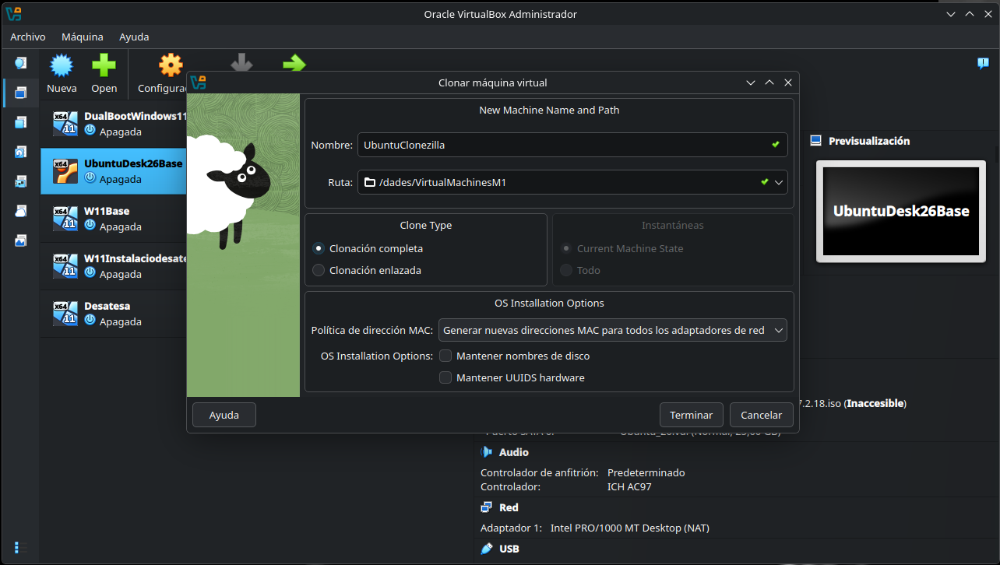

> [!IMPORTANT]
> Fem una clonació completa i a l'apartat de *«Política de dirección MAC»* triem l'opció de generar noves adreces MAC.

Una vegada clonada, la iniciem per assegurar-nos que tot s'ha clonat de manera correcta.

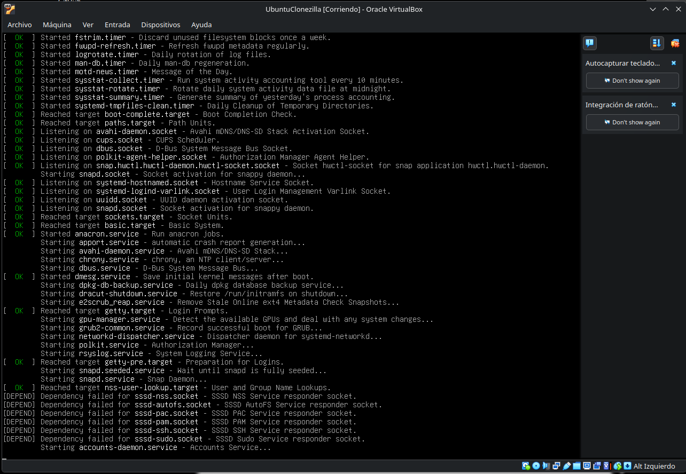

### Descarreguem Clonezilla

En iniciar, si tot està correcte, descarreguem Clonezilla. El podem descarregar a la màquina virtual o a l'ordinador *host*, recomano fer-ho al PC *host*, ja que així ens estalviem després passar la ISO amb carpetes compartides.

El primer pas és obrir al nostre navegador web l'enllaç de descàrrega de [Clonezilla](https://sourceforge.net/projects/clonezilla/files/latest/download)

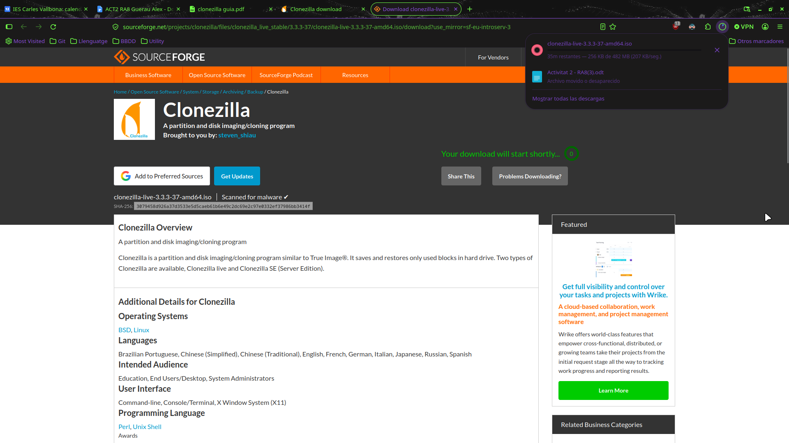

o bé podem accedir a la seva [web](https://clonezilla.org/).

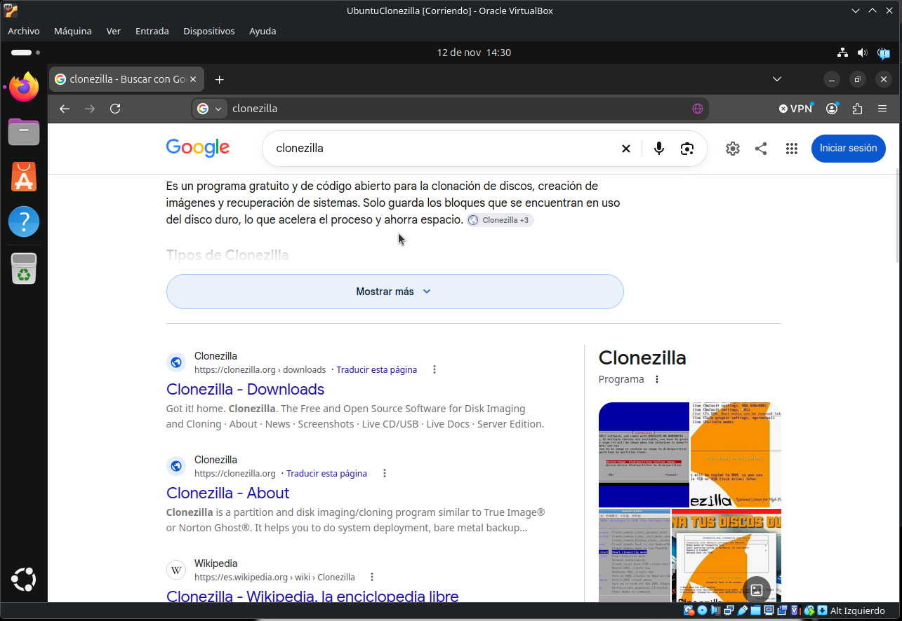

Fem clic a l'apartat de descàrregues i triem la versió que preferim: la **principal** és basada en Debian (*Debian-based*) i l'**alternativa** és basada en Ubuntu (*Ubuntu-based*).

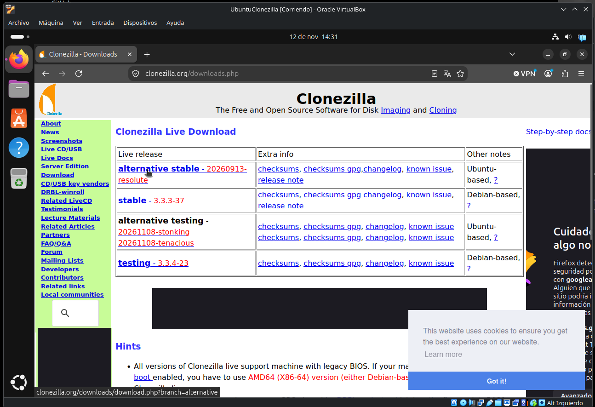

Totes dues opcions ens donen el mateix resultat: una descàrrega de la ISO de Clonezilla. Una vegada tenim la ISO, el procés és diferent segons si el volem fer a una MV o al nostre PC. A continuació explicaré com fer-ho a una màquina virtual, però aquí deixo un [enllaç](https://www.youtube.com/watch?v=A52PloXVzPc&t=11) d'una explicació de com convertir un USB en un *LiveBoot* amb Rufus, i el procés a seguir és similar.

### Preparem la màquina virtual per a la clonació

Tanquem la nostra màquina virtual i fem clic a la màquina que volem utilitzar per a la clonació. Una vegada estigui seleccionada, a la part superior de VirtualBox fem clic a l'engranatge gran anomenat *Configuració* (*Ajustes*) i se'ns obrirà una nova finestra. Aquí baixem fins a l'apartat d'emmagatzematge i fem clic a la icona d'un disc dur amb un `+`.

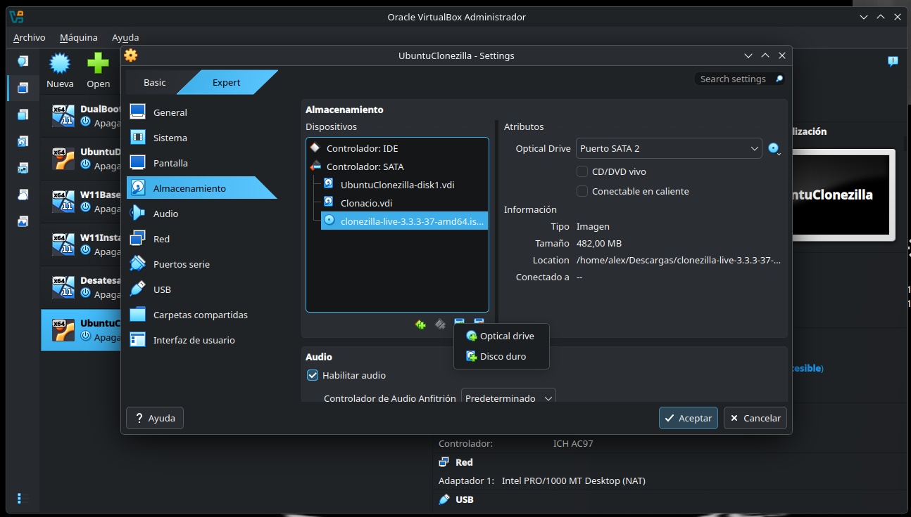

> [!NOTE]
> Es recomana triar la màquina virtual que ja té el disc dur que volem clonar per tal de no haver d'afegir-lo després.

S'obrirà un menú on ens deixa modificar, afegir o treure discs durs virtuals nous. Aquí hem de crear un nou disc dur, recomano que tingui més espai que el disc dur origen, o com a mínim la mateixa capacitat, ja que si no és possible que no tingui espai suficient per a la clonació completa.

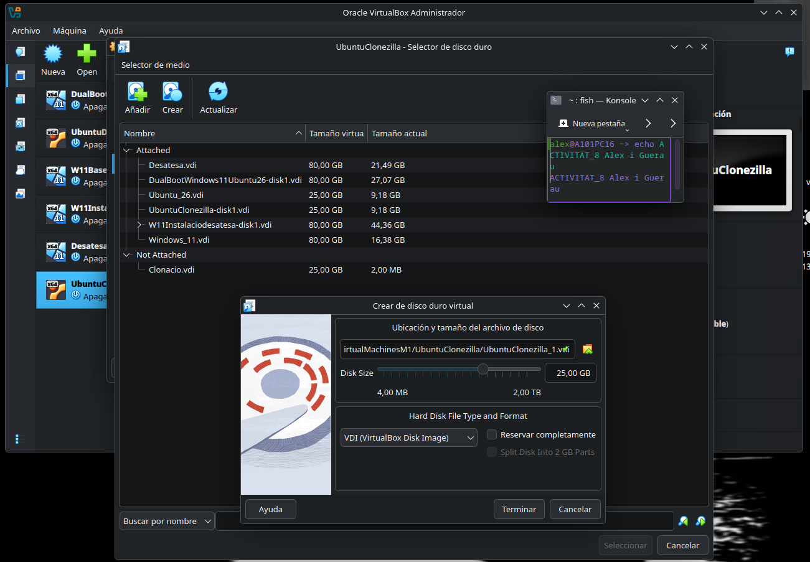

Fem el mateix després, però fent clic a la icona del DVD, i afegim la ISO del Clonezilla.

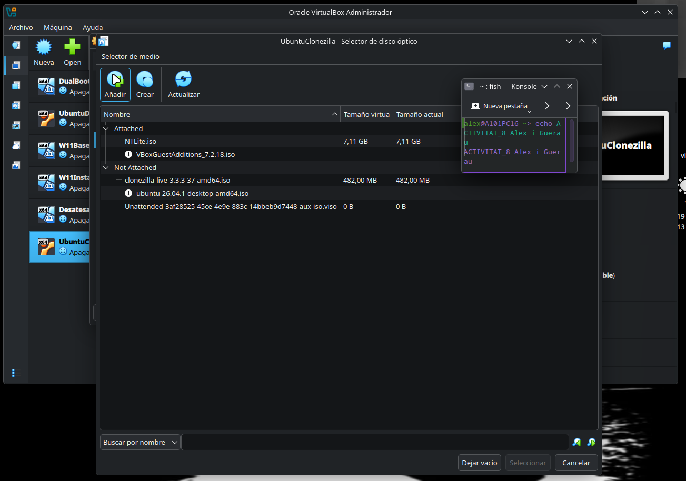

Finalment, a la finestra de configuració pugem fins a l'apartat *«Sistema»* i ajustem l'ordre d'arrencada perquè el disc òptic sigui el primer i així evitar iniciar Ubuntu.

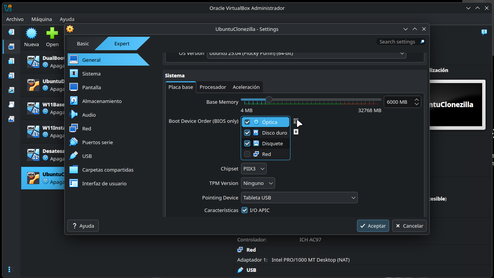

### Iniciem Clonezilla

Una vegada hem afegit el nou disc dur, la ISO i hem modificat l'ordre d'inici, podem tancar-ho tot i iniciar la màquina virtual. Si ho hem fet tot bé veurem la pàgina d'inici de Clonezilla, que és molt similar al menú de GRUB amb el qual ja estem familiaritzats.

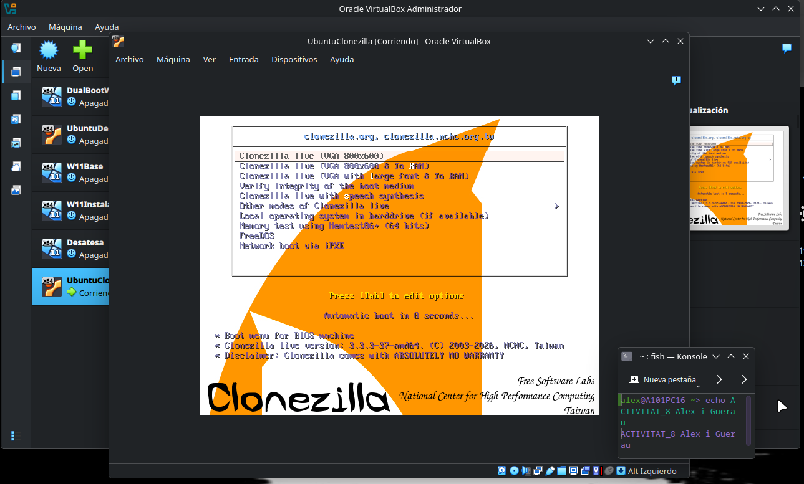

> [!NOTE]
> Per confirmar premem la tecla <kbd>Enter</kbd>
>
> Per seleccionar una opció premem <kbd>Espai</kbd> / <kbd>Spacebar</kbd>

Triem la primera opció, o podem esperar uns segons i s'iniciarà automàticament. Deixem uns segons perquè carregui tot bé i ens trobarem en un menú amb fons blau on ho configurarem tot per a la clonació.

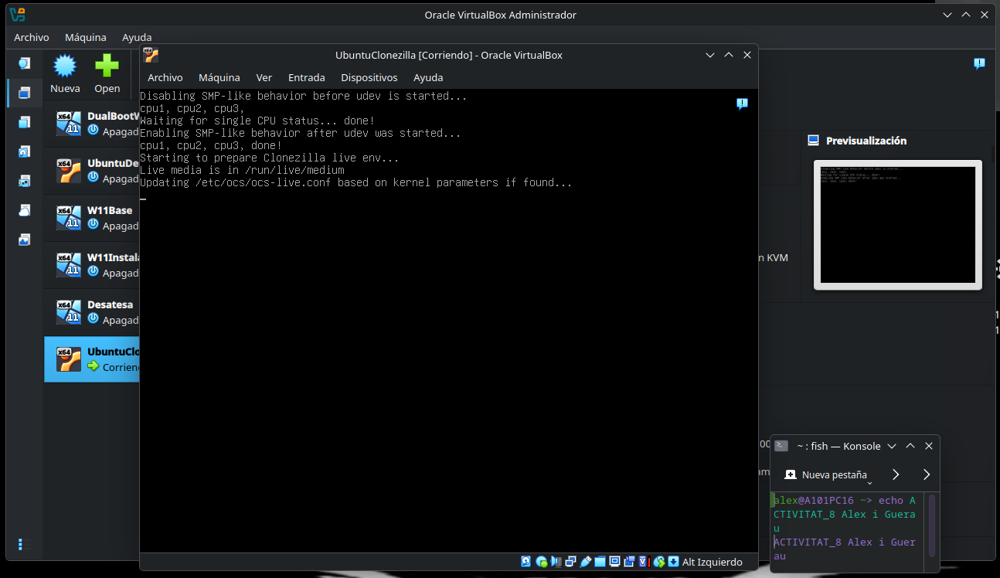

### El procés de la clonació

Ara que ja som a la pantalla inicial triem l'idioma i la distribució del teclat. Jo he triat `en_US.UTF-8` i he mantingut la distribució per defecte (`US`), però realment no hi ha gaire cosa a escriure, així que pots triar la configuració que prefereixis.

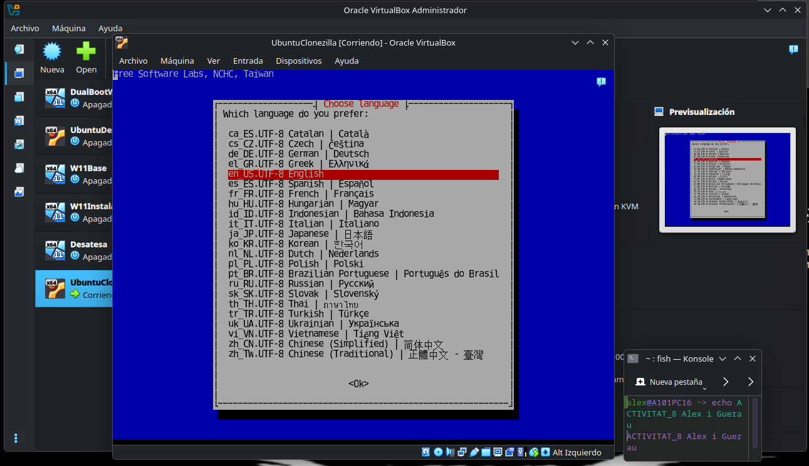

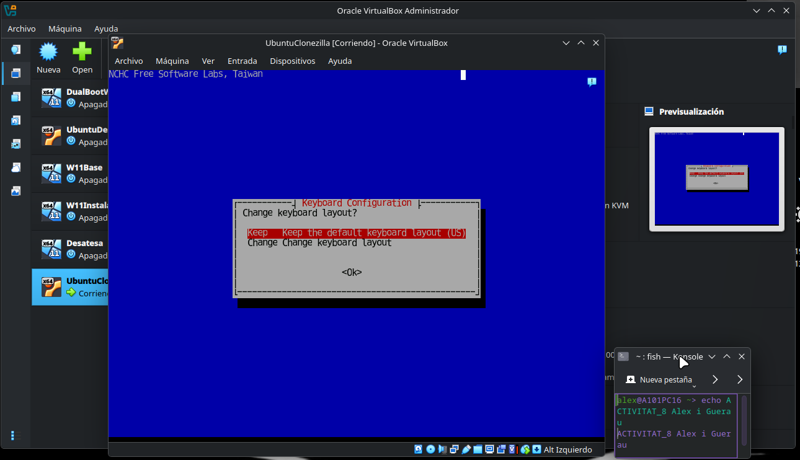

Ara som a un menú on podem triar executar un script de *shell* o iniciar Clonezilla, nosaltres triem aquesta segona opció.

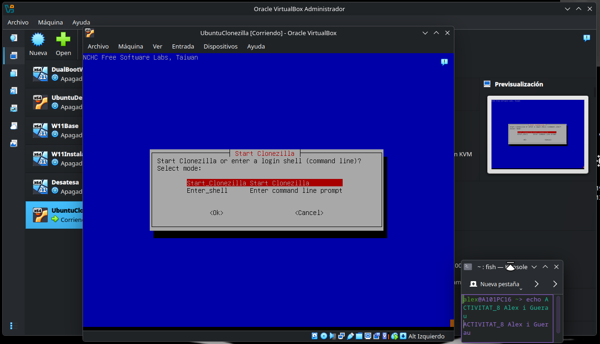

Aquest menú on ens trobem ara ens permet triar el tipus de clonació a realitzar, ja sigui:

- `device-image`: serveix per guardar un disc o partició com a imatge ISO a un disc local, xarxa o servidor remot. S'usa comunament per fer còpies de seguretat o instal·lacions repetides.
- `device-device`: copia informació directament d'un disc o partició origen a un disc o partició destí, és útil per a migracions d'un disc a un altre. **Aquesta és l'opció que triarem nosaltres.**
- `remote-source`: configura l'equip actual com a màquina d'origen per enviar les dades d'un disc o partició directament a un altre ordinador a través de la xarxa. És molt útil per clonar un equip a un altre sense haver d'extreure els discs físics ni usar memòries USB externes.
- `remote-dest`: configura l'equip actual com a màquina de destí per rebre les dades d'un disc o partició enviades per xarxa des d'un equip en mode `remote-source`. S'utilitza com a parella de l'opció anterior per completar la clonació directa punt a punt per xarxa.
- `lite-server`: converteix l'equip en un servidor de clonació massiva per distribuir una imatge o un disc local a múltiples ordinadors alhora mitjançant la xarxa local (*multicast* o *BitTorrent*). És ideal per desplegar un mateix sistema operatiu en aules d'informàtica, empreses o laboratoris amb molts equips idèntics.
- `lite-client`: configura l'equip com a client per connectar-se a un servidor `lite-server` de la xarxa local i rebre automàticament la clonació massiva. S'usa en tots els ordinadors de destí dins d'un desplegament simultani per xarxa.

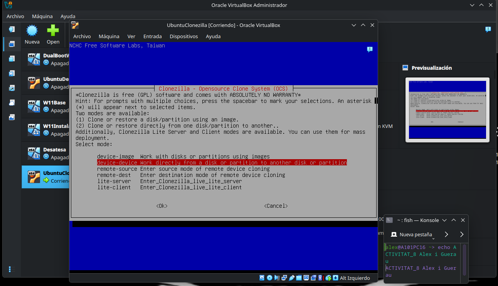

Triem el mode **`Expert`** per poder canviar algunes opcions, però si només vols clonar el disc dur és recomanable triar l'altra opció (*`Beginner`*), ja que t'exposes menys a trobar-te amb problemes.

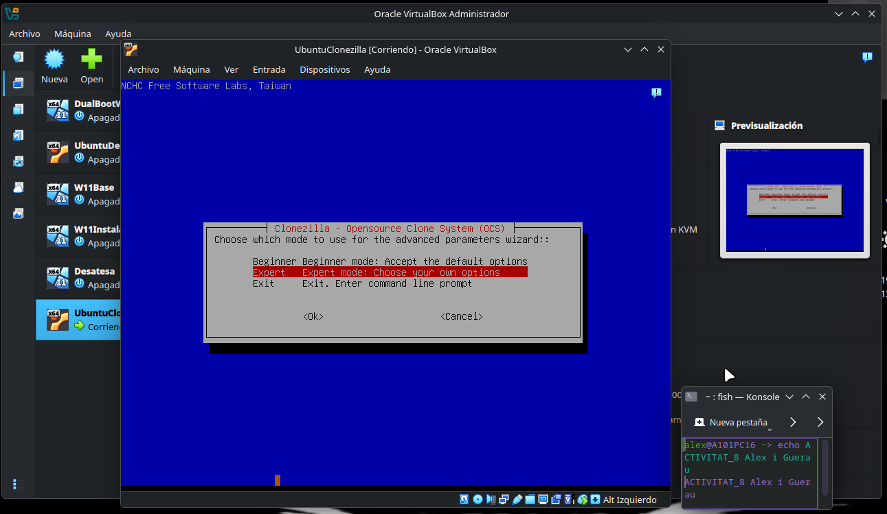

Com que volem fer una clonació d'un disc a un altre, triem la primera opció (`disk_to_local_disk`). Si vols fer una clonació d'una partició específica has de triar la segona opció (`part_to_local_part`).

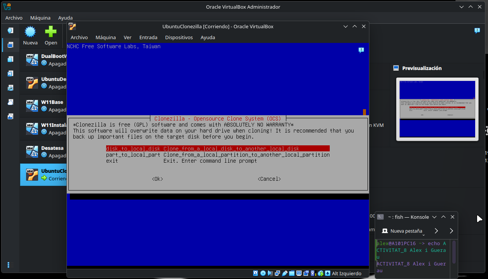

Aquí em vaig topar amb diferents problemes que documentaré a continuació, si voleu anar directament a la manera correcta podeu saltar a l'apartat [Clonació correcta](#clonació-correcta) per veure el procés final.

### Troubleshooting clonació

Ens trobem a l'apartat on més atenció hem de tenir, ja que si triem el disc incorrecte ho podem arribar a perdre tot. Triem primer el disc origen, que té totes les dades que volem clonar, amb <kbd>Espai</kbd> / <kbd>Spacebar</kbd> *(sabrem que està seleccionat perquè tindrà un `*` dintre dels claudàtors)*, i premem <kbd>Enter</kbd>.

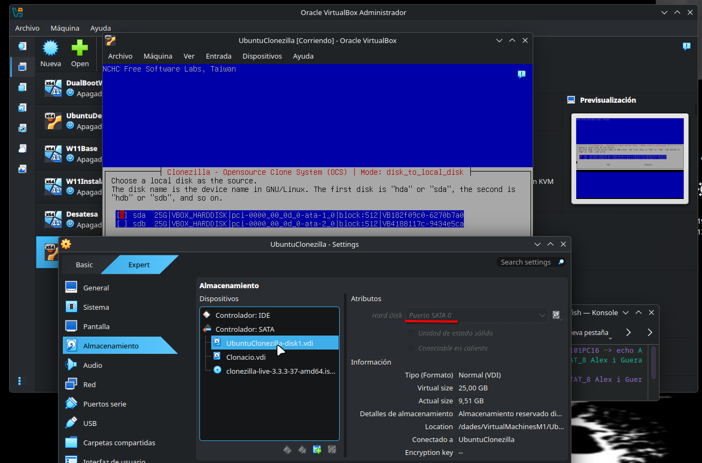

> [!TIP]
> Si els nostres discs tenen la mateixa mida, per poder saber la diferència podem mirar de nou la configuració de la nostra màquina virtual i veurem l'ordre dels discs: el primer serà sempre `hda` o `sda`, el segon `hdb` o `sdb` i així amb la resta de discs.

En prémer <kbd>Enter</kbd> arribarem a l'apartat on triarem el disc dur destí. Ens podem fixar que el que hem triat com a origen ja no apareix, per tant, aquí no ens hem de preocupar tant de fer alguna errada, a no ser que tinguem més de dos discs durs instal·lats al nostre ordinador.

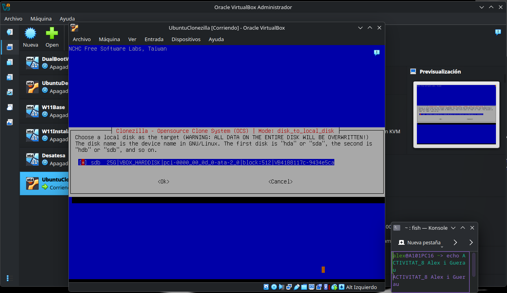

Aquest llistat permet triar instruccions especials a l'hora de fer la clonació. Jo, si no m'equivoco, ho he deixat per defecte, amb `-g`, `-e1`, `-e2`, `-j2` i `-r` seleccionats.

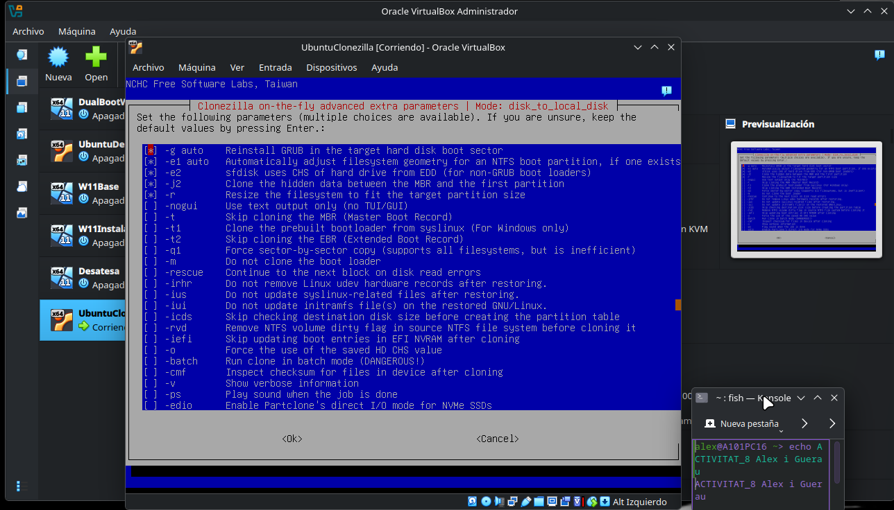

I aquesta finestra, per anar amb pressa, és la que em va acabar costant 4 intents fins a aconseguir-ho tot. Jo sempre triava **`-sfsck`** per anar més ràpid, aquesta opció li diu a Clonezilla que no verifiqui ni repari el sistema de fitxers origen.

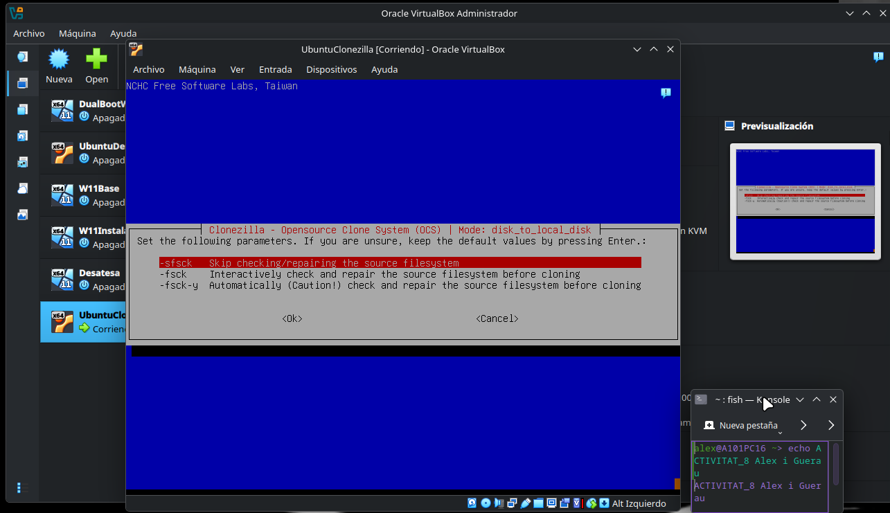

Ara triarem els paràmetres que seguirà Clonezilla a l'hora de crear particions al disc destí: `-k0` és l'opció per defecte que simplement copia les particions del disc origen, `-k` demana que no es faci una taula de particions al disc objectiu, i `-k1` i `-k2` són opcions més avançades on podem triar la manera en què es creen les taules de particions. Nosaltres triem **`-k0`**.

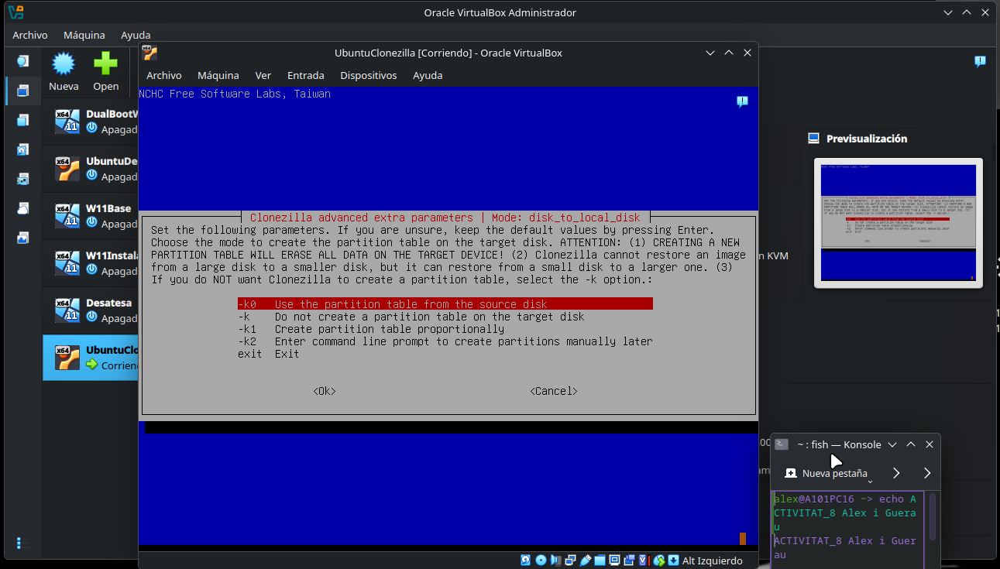

Si tenim Clonezilla en un USB, podem triar si volem crear o no els *log files*, jo vaig triar no generar-los.

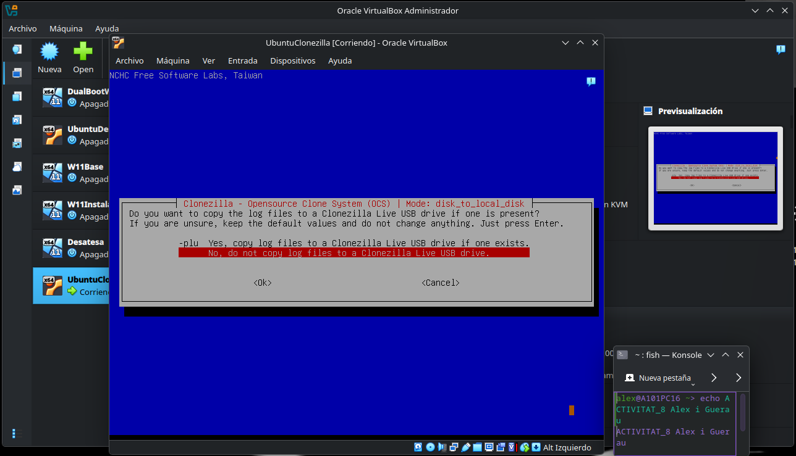

I aquí podem triar què fer una vegada acabi la clonació: apagar, reiniciar o executar alguna ordre específica.

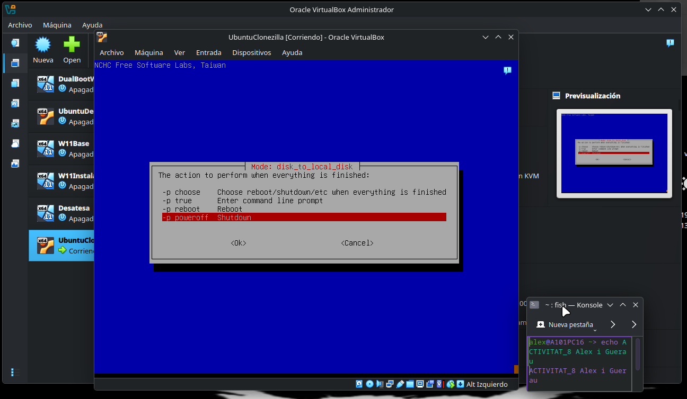

A continuació deixaré unes imatges del procés de clonació on ens demana alguns *inputs* extra, com prémer <kbd>Enter</kbd> o triar `y/N` (sí o no). Jo vaig dir que sí a tot, ja que estava segur que volia continuar, recomano llegir bé el text en groc que t'explica què està a punt de passar.

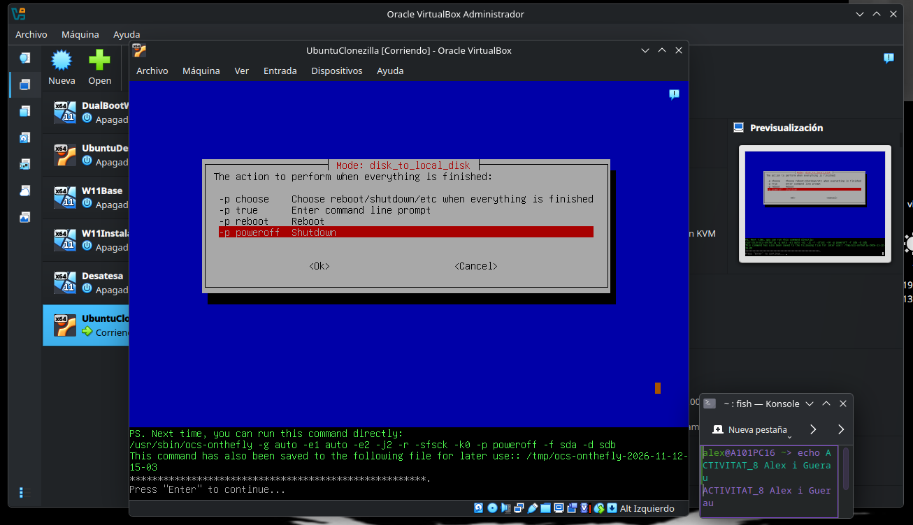

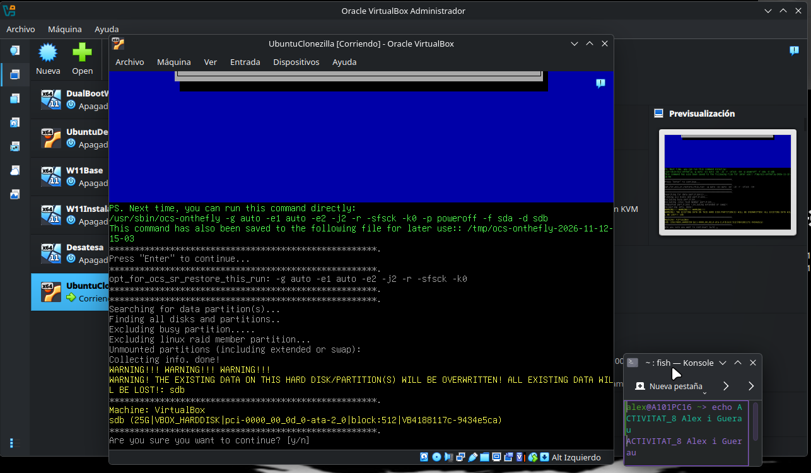

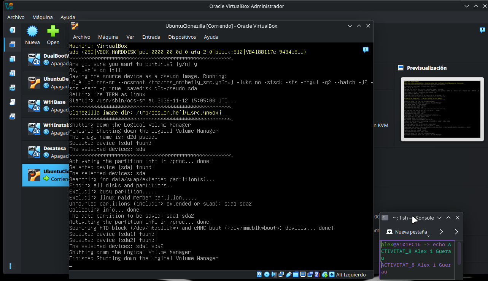

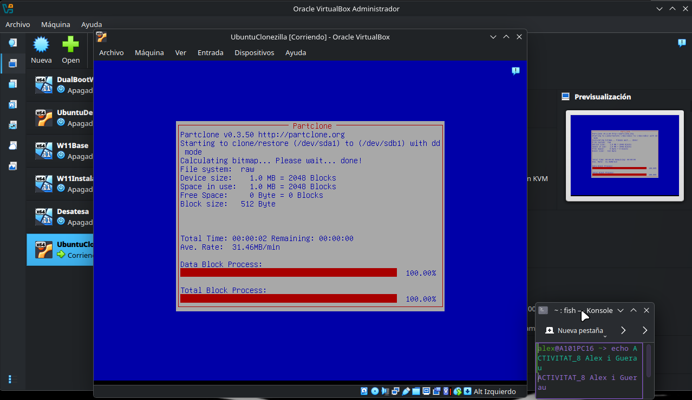

Aquest procés hauria de portar un temps, però a mi no em trigava ni 2 segons.

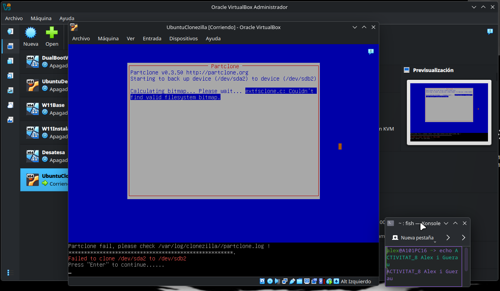

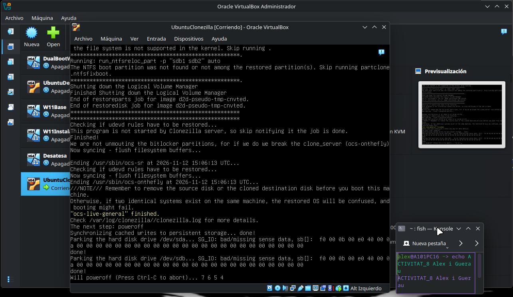

Vaig repetir aquest procés 4 vegades fins que el vaig solucionar i vaig aconseguir la clonació final.

### Clonació correcta

Aquí explicaré l'intent que em va funcionar. El procés és gairebé tot igual, per tant, algunes captures són d'intents anteriors, menys les de les opcions diferents que vaig triar. Així doncs, si triem totes les opcions indicades a continuació farem una clonació correcta.

> [!TIP]
> Si els nostres discs tenen la mateixa mida, per poder saber la diferència podem mirar de nou la configuració de la nostra màquina virtual i veurem l'ordre dels discs: el primer serà sempre `hda` o `sda`, el segon `hdb` o `sdb` i així amb la resta de discs.

En prémer <kbd>Enter</kbd> arribarem a l'apartat on triarem el disc dur destí. Ens podem fixar que el que hem triat com a origen ja no apareix, per tant, aquí no ens hem de preocupar tant de fer alguna errada, a no ser que tinguem més de dos discs durs instal·lats al nostre ordinador.

Ens topem amb un llistat que ens permet triar instruccions especials a l'hora de fer la clonació, jo ho he deixat per defecte, amb `-g`, `-e1`, `-e2`, `-j2` i `-r` seleccionats.

Triarem **`-fsck`**. Així es revisaran i repararan els sistemes de fitxers d'origen abans de la clonació (evitant l'error que ens donava abans amb `-sfsck`).

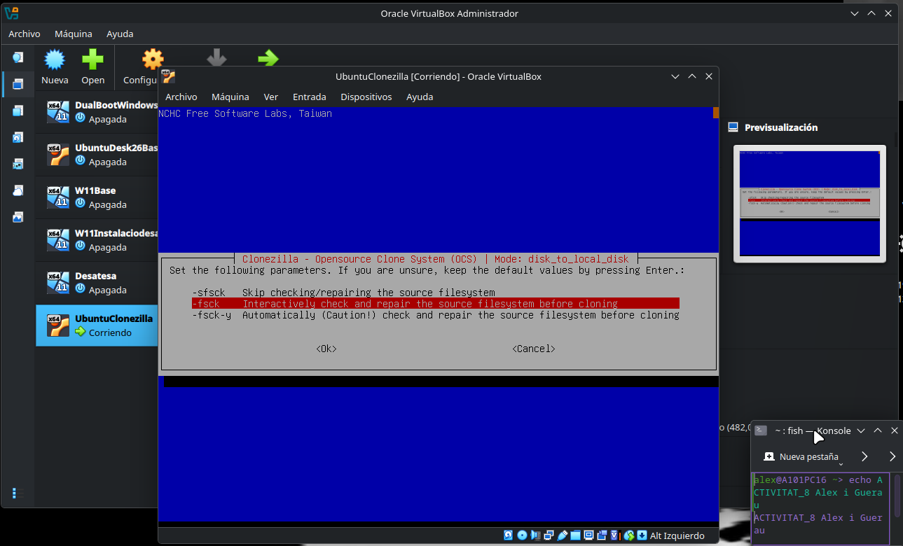

Ara triarem els paràmetres que seguirà Clonezilla a l'hora de crear particions al disc destí: `-k0` és l'opció per defecte que simplement copia les particions del disc origen, `-k` demana que no es faci una taula de particions al disc objectiu, i `-k1` i `-k2` són opcions més avançades on podem triar la manera en què es creen les taules de particions. Nosaltres triem **`-k0`**.

Si tenim Clonezilla en un USB, podem triar si volem crear o no els *log files*, jo vaig triar no generar-los.

Aquí podem triar què fer una vegada acabi la clonació: apagar, reiniciar o executar alguna ordre específica.

A continuació deixaré unes imatges del procés de clonació on ens demana alguns *inputs* extra, com prémer <kbd>Enter</kbd> o triar `y/N` (sí o no). Jo vaig dir que sí a tot, ja que estava segur que volia continuar, recomano llegir bé el text en groc que t'explica què està a punt de passar.

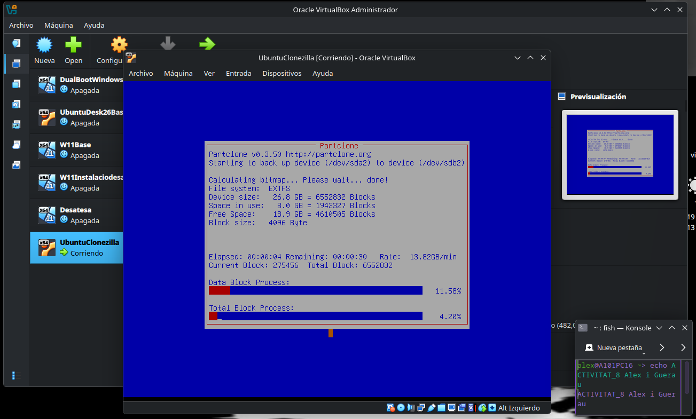

> [!NOTE]
> Aquest procés trigarà un temps.

Una vegada es completi i s'apagui l'ordinador, treurem el disc dur antic per comprovar si funciona tot correctament.

Anem primer de tot al menú de configuració de nou, seleccionem l'apartat d'emmagatzematge, seleccionem el disc antic i fem clic a la icona d'un disc amb una creu per eliminar-lo. Hauria de quedar només el nou disc.

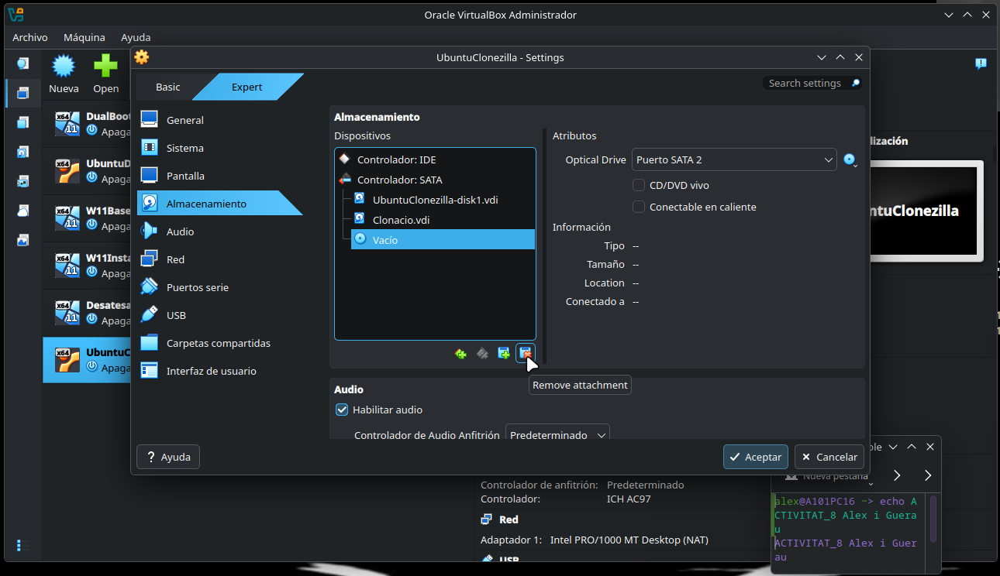

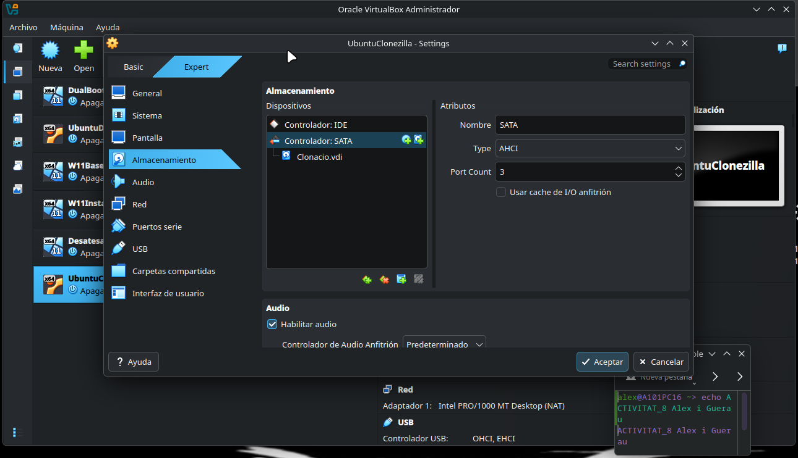

Ens trobem ara a l'escriptori Ubuntu de l'inici però amb el nou disc. Si tot s'ha fet bé no hauríem de notar cap diferència. *Si ho has fet amb dos discs físics reals i has passat d'un HDD a un SSD, el que sí que notaràs és la velocitat superior que té el teu nou disc!*

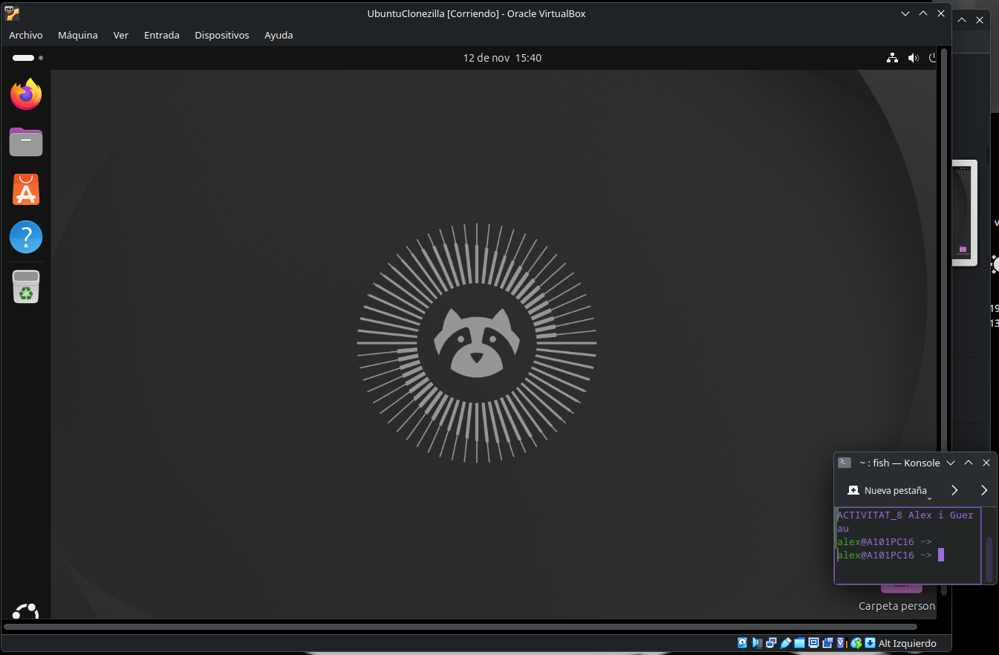

## Conclusió

Aquesta pràctica m'ha permès entendre el funcionament real de la clonació de discos en entorns Linux mitjançant **Clonezilla**, una eina imprescindible en l'administració de sistemes per a tasques de còpia de seguretat, migració de maquinari (com el pas d'un HDD a un SSD) i desplegament massiu d'equips.

Més enllà de seguir els passos bàsics, la resolució de problemes (*troubleshooting*) durant el procés m'ha demostrat la importància de verificar la integritat del sistema de fitxers abans de clonar. L'ús del paràmetre `-fsck` en lloc d'ometre la comprovació amb `-sfsck` ha resultat clau per evitar errors de lectura de blocs amb *Partclone* i garantir que la còpia al disc destí sigui completament funcional i arrencable. Finalment, validar el resultat desconnectant el disc original confirma que el sistema clonat manté intactes tant les particions com el gestor d'arrencada.

## Webgrafia

- **[Clonezilla – Pàgina oficial i documentació](https://clonezilla.org/)**
- **[Clonezilla – Descàrregues oficials (SourceForge)](https://sourceforge.net/projects/clonezilla/)** 
- **[Oracle VM VirtualBox – Documentació oficial](https://www.virtualbox.org/)** 
- **[Tutorial crear USB LiveBoot amb Rufus (YouTube)](https://www.youtube.com/watch?v=A52PloXVzPc)**
- **[PDF del moodle](https://moodle.iescarlesvallbona.cat/pluginfile.php/292555/mod_resource/content/20/clonezilla%20guia.pdf)**

*Ús de la IA (Gemini): En aquesta activitat he utilitzat la IA per corregir errors ortogràfics, i d'estructura del markdown, juntament amb el corrector de [Softcatalà](https://www.softcatala.org/corrector/).*

