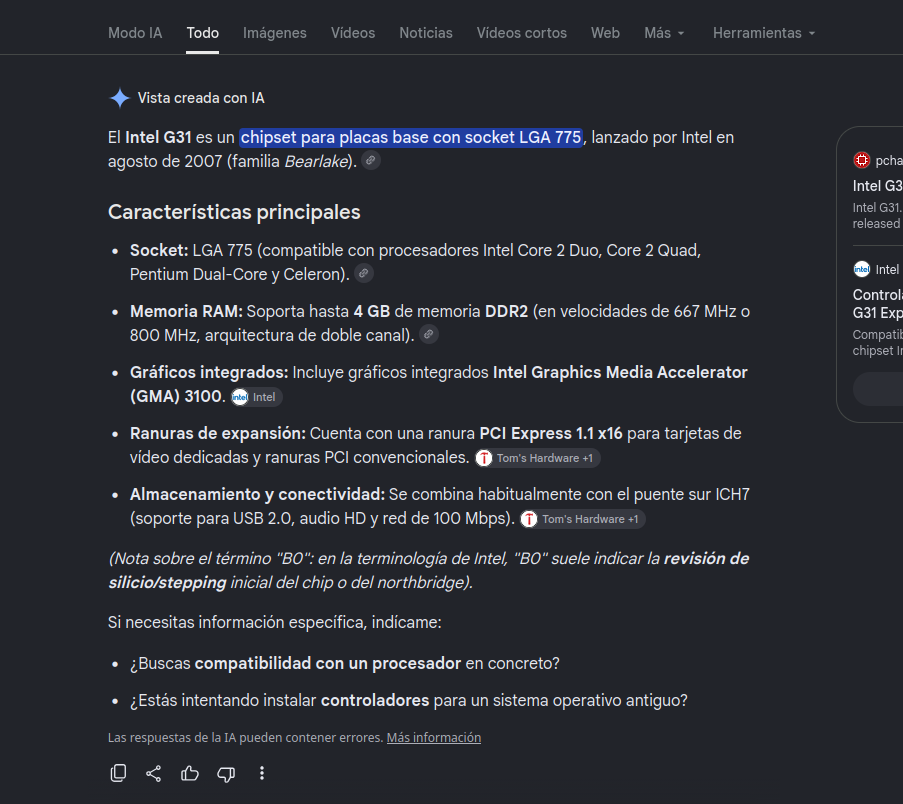
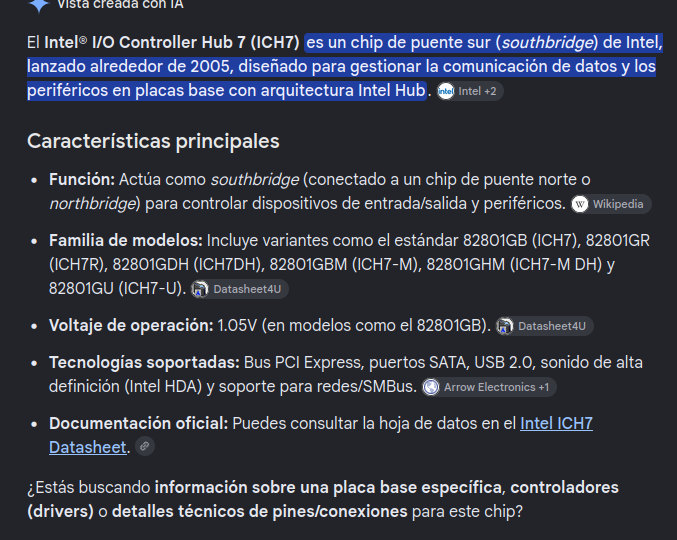

Pagina 7: Processador [Intel Pentium E5400](https://www.techpowerup.com/cpu-specs/pentium-e5400.c853)
-    2 Cores
-    2 Threads
-    65 W TDP
-    2.7 GHz Frequency
-    Socket 775 Socket

|Performance| |
|---|---|
|Frequency: 	|2.7 GHz|
|Turbo Clock: 	|N/A|
|Base Clock: 	|200 MHz|
|Multiplier: 	|13.5x|
|Multiplier Unlocked: 	|No|
|Voltage: 	|1.3625 V|
|TDP: 	|65 W|

Pagina 8: RAM [Kingston KVR800D2N6/2G](https://www.kingston.com/dataSheets/KVR800D2N6_2G.pdf)

|SPECIFICATIONS||
|---|---|
|Clock Cycle Time (tCK)| 2.5ns (min.) / 8ns (max.)|
|Row Cycle Time (tRCmin)| 60ns (min.)|
|Refresh to Active/Refresh  Command Time (tRFCmin)| 127.5ns (min.)|
|Row Active Time (tRASmin)| 45ns (min.) / 70,000 (max.)|
|Single Power Supply of| +1.8V (+/- .1V)|
|Power Operating| 2.016 W (Approx.*)|
|UL Rating| 94 V - 0|

Pagina 8: "Xipset" -> Xips de Lògica Central/Core Logic Chipset
North brige es un intel g31 B0 i south bridge es un Intel ICH7 [credits theretroweb](https://theretroweb.com/motherboards/s/asus-p5kpl-am-in-roem-si-rev-1-03g)

[NorthBride](https://www.intel.com/Assets/PDF/datasheet/317495.pdf)
- Descripció feta per el modo ia de google 
El Intel G31 es un chipset para placas base con socket LGA 775, lanzado por Intel en agosto de 2007 (familia Bearlake).

Características principales

• Socket: LGA 775 (compatible con procesadores Intel Core 2 Duo, Core 2 Quad, Pentium Dual-Core y Celeron).
• Memoria RAM: Soporta hasta 4 GB de memoria DDR2 (en velocidades de 667 MHz o 800 MHz, arquitectura de doble canal).
• Gráficos integrados: Incluye gráficos integrados Intel Graphics Media Accelerator (GMA) 3100.
• Ranuras de expansión: Cuenta con una ranura PCI Express 1.1 x16 para tarjetas de vídeo dedicadas y ranuras PCI convencionales.
• Almacenamiento y conectividad: Se combina habitualmente con el puente sur ICH7 (soporte para USB 2.0, audio HD y red de 100 Mbps).

[SouthBrige](https://www.intel.com/content/dam/doc/datasheet/i-o-controller-hub-7-datasheet.pdf)
- Descripció ia 

El Intel® I/O Controller Hub 7 (ICH7) es un chip de puente sur (southbridge) de Intel, lanzado alrededor de 2005, diseñado para gestionar la comunicación de datos y los periféricos en placas base con arquitectura Intel Hub.

Características principales

• Función: Actúa como southbridge (conectado a un chip de puente norte o northbridge) para controlar dispositivos de entrada/salida y periféricos.
• Familia de modelos: Incluye variantes como el estándar 82801GB (ICH7), 82801GR (ICH7R), 82801GDH (ICH7DH), 82801GBM (ICH7-M), 82801GHM (ICH7-M DH) y 82801GU (ICH7-U).
• Voltaje de operación: 1.05V (en modelos como el 82801GB).
• Tecnologías soportadas: Bus PCI Express, puertos SATA, USB 2.0, sonido de alta definición (Intel HDA) y soporte para redes/SMBus.
• Documentación oficial: Puedes consultar la hoja de datos en el Intel ICH7 Datasheet.
¿Estás buscando información sobre una placa base específica, controladores (drivers) o detalles técnicos de pines/conexiones para este chip?

- Recomanaria pasar els 2 pdfs a Gemini gpt o lo que sea i que contesti a quines son les dades de cada un, jo no ho faig que estic sense tokens xd

Pagina 9: PCI 
El blau es un PCI express de 16 (PCIEX16)
Els altres dos son PCI que només tenien una mida estandard (PCI1,PCI2)
Els PCIs es fan servir per instalar targetes d'expansió, els convencionals utilitzan un standard que comparteix bus compartint torns els dispositius per comunicarse, mentre que el pcie te una arquitectura de punt a punt amb busos dedicats (x1,x4,x8 o x16) amb rutas exclusives per cada pcie

Els usos mes comuns son:
- Targetes gràfiques (GPUs): Instal·lada en ranures x16 per gestionar el processament de vídeo i jocs d'amplada de banda alta.
- Dispositius d'emmagatzematge: S'utilitza per a unitats d'estat sòlid ràpid (NVMe/PCIe SSDs) o controladors d'emmagatzematge/RAID.
- Adaptadors de xarxa: S'utilitza per a afegir targetes Wi-Fi, targetes Ethernet o interfícies de xarxa de fibra òptica.
- Targetes d'àudio i captura: S'utilitza per a targetes de so dedicades o targetes de captura de vídeo/TV.
- Expansió perifèrica: s'utilitza per afegir ports USB addicionals, ports sèrie o targetes acceleradores especialitzades(GPUs, FPGAs, ASICs, NPU/Acceleradors d'IA...).

Pagina 9: SATA, afegir que son l'estandard SATA II que es la segona gen, de SATA amb velocitats de transferencia de fins a 3 Gbps(molt superior que els 1.5Gbps del SATA original), que degut a codificació de dades 6b/10b la velocitat real acostuma a ser 300 MB/s de lectura i escriptura.

Pagina 9: Par inferior 

A la part inferior trobem de esquerra a dreta:
- AAFP(Advanced Audio Frontal anel): Connector d'àudio frontal. Serveix per connectar els ports de jack de 3.5 mm (auriculars i micròfon) i el circuit d'àudio de la torre a la placa base.
- F_PANEL: Agrupa els pins per als botons del panell frontal, (engegada, reinici, i leds indicadors)
- SB_PWR led: Indicador d'energia en espera, indica si l'equip esta en standby aprofitant que la PSU administra corrent als circuits standy(+5VSB) fins i tot amb el PC apagat
- USB78: Header usb intern (USB 2.0) per afegir 2 ports adicionals (7 i 8)
- USB56: Header usb intern (USB 2.0) per afegir 2 ports adicionals (5 i 6)
- PRI_IDE: Conector IDE primari d'una placa base, utilitzat per comunicar la placa base amb dispositius d'emmagatzematge masiu (disc durs ATA/PATA, CDs/DVDs...)
- CLRTC (Clear RTC RAM): pins utilitzats per esborrar memoria CMOS i resetejar la BIOS a valors de fabrica
- SPEAKER: altaveu intern que emet codis de pitidos durant el POST(Power-On Self-Test) per avisar de possibles errors de inici, l'estandar actual son llums de post que fan mes façil identificar errors.
- PILA de CMOS: Pila (normalment CR2032) que serveix per subministrar energia constant al xip de la BIOS/CMOS quan el PC està fora de la corrent, evitant que es perdin la data, l'hora i la configuració del maquinari.